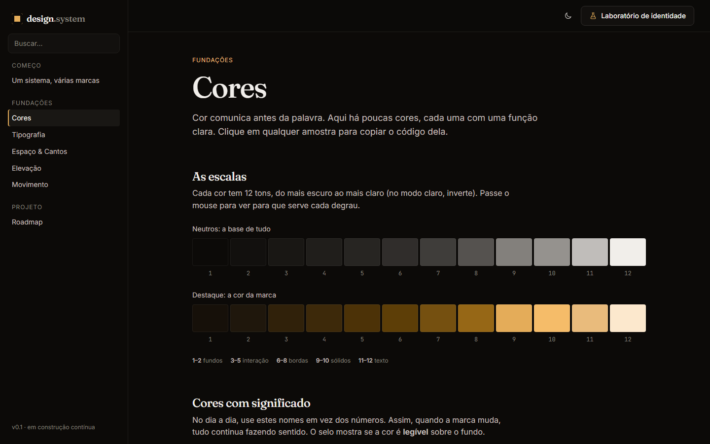
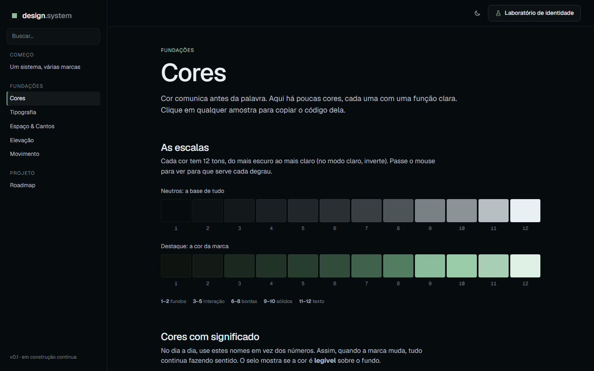
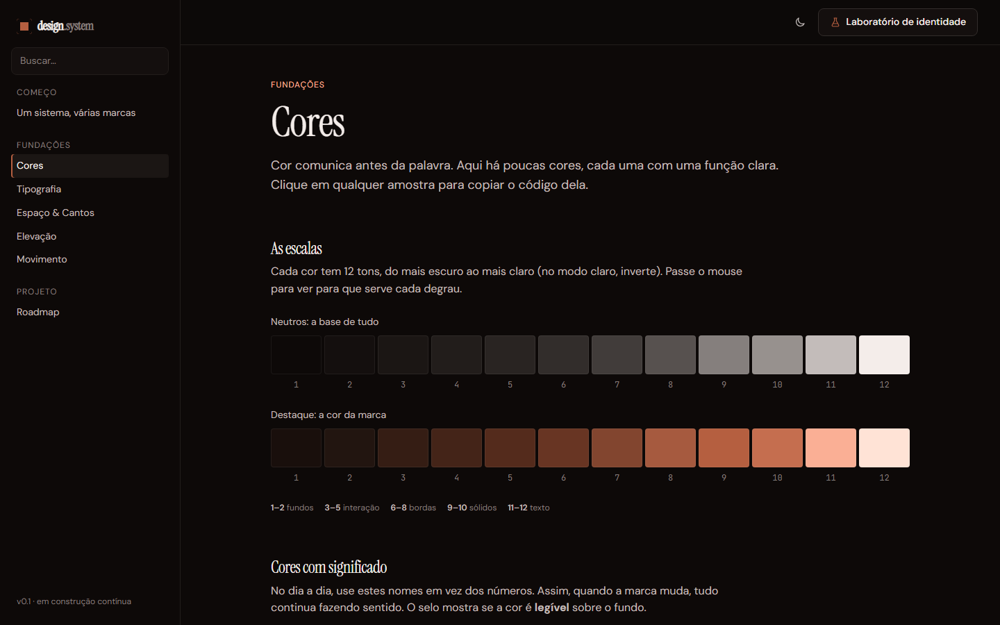
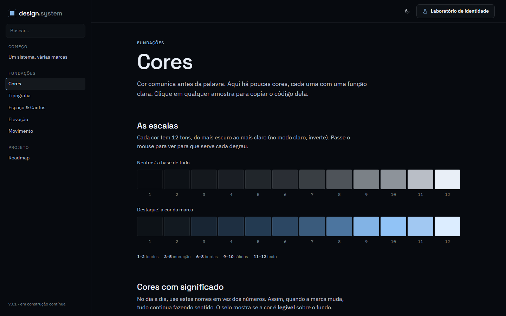
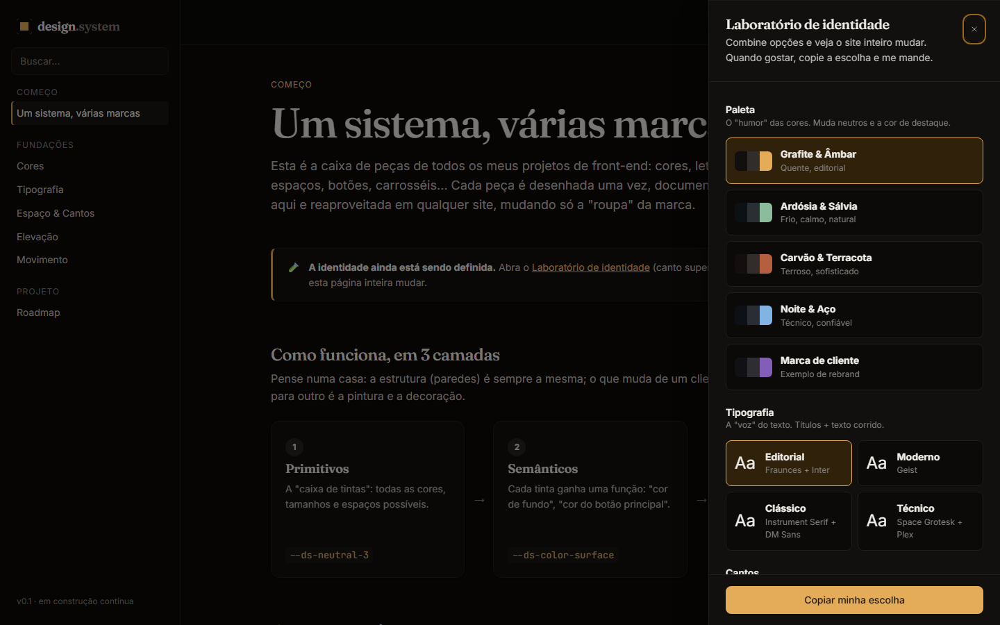

# 001 — Fundações e Laboratório de identidade

**Data:** 2026-10-20 · **Versão:** 0.1 · **Prints:** [`prints/2026-10-20_fundacoes/`](prints/2026-10-20_fundacoes/)

## Contexto
Ponto de partida do projeto. Como dev front-end focado em sites para clientes, eu recriava cores,
botões e espaçamentos do zero a cada trabalho. O objetivo é ter **uma caixa de peças própria**,
documentada de um jeito bonito e interativo (até para quem não é da área), que eu possa
**rebrandizar** para cada cliente. Ainda **não existe identidade visual** própria: ela vai ser
construída junto com o sistema.

Referência de formato (não de estilo): um styleguide navegável com fundações + componentes + variantes ao vivo.

## O que foi feito
- **Arquitetura de tokens em 3 camadas** (prefixo `--ds-`):
  1. *Primitivos*: escalas de cor de 12 passos geradas em **OKLCH** a partir de só 4 números (matiz e croma dos neutros e do destaque), além de espaço (base 4px), raios, tipografia, movimento e z-index.
  2. *Semânticos*: nomes por função (`--ds-color-surface`, `--ds-color-text-muted`, `--ds-color-accent`…). Componentes só usam esta camada.
  3. *Temas*: atributos no `<html>` (`data-theme`, `data-font`, `data-radius`, `data-mode`). Uma marca de cliente é um arquivo de ~10 linhas.
- **4 propostas de identidade da casa:** Grafite & Âmbar, Ardósia & Sálvia, Carvão & Terracota, Noite & Aço. Mais um tema "marca de cliente" de exemplo.
- **4 pares tipográficos:** Editorial (Fraunces + Inter), Moderno (Geist), Clássico (Instrument Serif + DM Sans), Técnico (Space Grotesk + IBM Plex).
- **Modo escuro (padrão) e claro.**
- **Site de documentação** (Vite, JS puro) com as páginas Início, Cores, Tipografia, Espaço & Cantos, Elevação, Movimento e Roadmap.
- **Laboratório de identidade:** painel lateral que troca paleta, fonte, cantos e modo ao vivo no site inteiro, e copia a combinação escolhida.
- **Interatividade pensada para leigos:** clicar copia o token, um selo de contraste é calculado ao vivo, você digita o próprio texto na escala tipográfica, um card muda de espaçamento com um clique, bolinhas demonstram as curvas de animação.
- **Ferramentas do processo:** `CLAUDE.md` (resumo enxuto das regras para a IA), `npm run prints` (capturas automáticas) e este diário.

## Decisões (e por quê)
| Decisão | Alternativas consideradas | Motivo |
|---|---|---|
| CSS custom properties + Web Components | React, Vue, Tailwind | Não ficar preso a um framework: funciona em qualquer projeto de cliente |
| Cores em OKLCH geradas por matiz/croma | Paleta fixa em hex | Rebrand com 4 números; luminosidade uniforme entre matizes; modo claro/escuro sai "de graça" |
| 3 camadas de tokens | Usar a paleta direto nos componentes | Trocar a marca sem tocar em nenhum componente |
| Escuro, sóbrio, **sem glow/neon** | Estética "tech neon" | Preferência pessoal; profundidade vem de superfícies em camadas e bordas sutis |
| Identidade escolhida via Laboratório | Definir as cores de cara | Construir a identidade junto, comparando ao vivo |
| Documentação em português para leigos | Docs técnicas em inglês | Clientes e não-devs também precisam entender |

## Problemas encontrados
- **Texto "discreto" com contraste 4.3** (abaixo do mínimo de 4.5 da WCAG) → clareei o passo 9 dos neutros. O próprio selo de contraste da página denunciou o problema.
- **Destaque sólido ilegível no modo claro** (contraste 2.0 sobre o fundo) → no modo claro, o destaque escurece automaticamente 0.14 de luminosidade.
- **Texto sobre o botão fraco** nas paletas Terracota (3.1) e Marca de cliente (3.6) → ajustei a luminosidade-base do destaque.
- **No modo claro, superfícies elevadas ficavam mais escuras** → no claro, a lógica inverte: fundo levemente cinza e cards brancos.
- **Botão de menu aparecendo no desktop** → conflito de especificidade de CSS.
- **Prints de celular cortados** (o navegador headless não abre janelas estreitas) → moldura com iframe na largura exata.
- **Abrir `index.html` com dois cliques não funciona** (o navegador bloqueia módulos JS em `file://`) → é preciso usar `npm run dev`.

## Antes / depois
Primeira versão: não há "antes". Comparativo entre as propostas de paleta:

| Grafite & Âmbar | Ardósia & Sálvia |
|---|---|
|  |  |
| **Carvão & Terracota** | **Noite & Aço** |
|  |  |

Laboratório de identidade:

## Aprendizados
- Medir contraste automaticamente na própria documentação pega erros que o olho não pega no escuro.
- Gerar a paleta a partir de poucos parâmetros torna o "rebrand" trivial e mantém todas as marcas igualmente legíveis.
- Um resumo curto de regras (`CLAUDE.md`) economiza contexto e tokens da IA nas próximas sessões.

## Próximos passos
- [ ] Escolher a identidade da casa no Laboratório
- [ ] Definir o nome do projeto e criar o repositório no GitHub
- [ ] Ícones (set próprio em SVG)
- [ ] Botões e botões de ícone

## Ideia de post
> **"Parei de recriar o mesmo botão em todo projeto."** Comecei meu próprio design system, o Nanquim:
> (1) uma marca de cliente inteira cabe em 4 números graças ao OKLCH; (2) a documentação mede o próprio contraste e me avisou de 3 erros; (3) a identidade visual está sendo escolhida ao vivo, num "laboratório".
> Print sugerido: grade com as 4 paletas, ou o Laboratório aberto.
