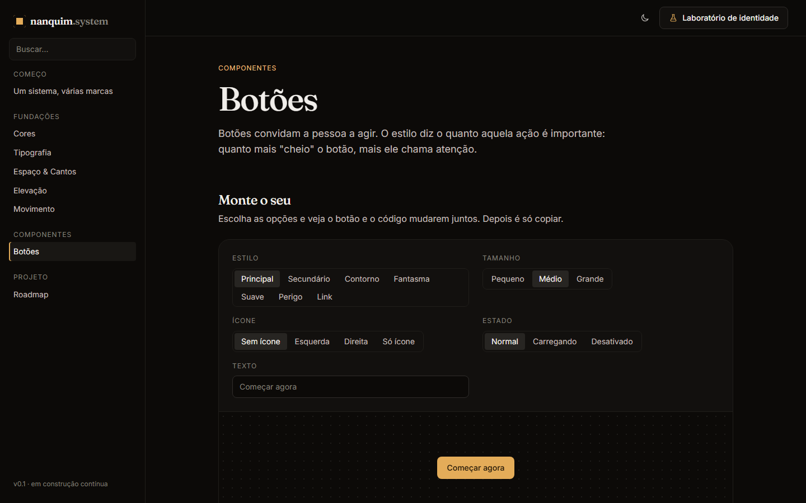
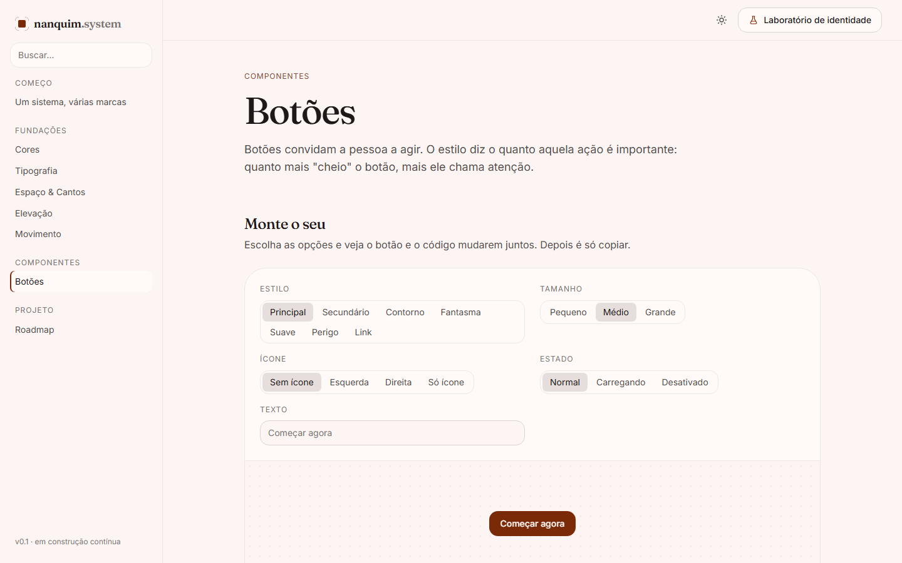
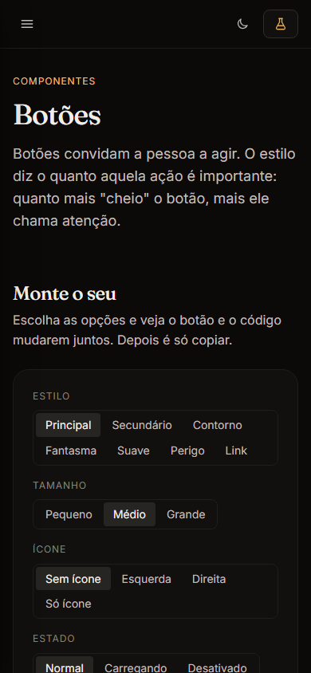

# 002 — Botões, o primeiro componente

**Data:** 2026-10-22 · **Versão:** 0.2 · **Prints:** [`prints/2026-10-22_botoes/`](prints/2026-10-22_botoes/)

## Contexto
Com as fundações prontas e a documentação publicada no GitHub Pages, o projeto ganhou nome (**Nanquim System**)
e repositório próprio. A identidade da casa ainda não foi escolhida, mas isso não trava o avanço:
como tudo é feito com tokens, o componente já nasce funcionando em todas as paletas.
O botão veio primeiro por ser o componente mais usado em qualquer site.

## O que foi feito
- **Componente `ds-btn`** em CSS puro (`src/components/button/button.css`):
  - 7 estilos: principal, secundário, contorno, fantasma, suave, perigo e link
  - 3 tamanhos: 32, 40 e 48px, todos na escala de espaço
  - ícone à esquerda, à direita ou só ícone (`ds-btn--icon`), largura total (`ds-btn--block`) e grupo (`ds-btn-group`)
  - estados de hover, pressionado, foco visível, desativado (`disabled` / `aria-disabled`) e carregando (`aria-busy="true"`)
- **Página de documentação** com:
  - um **playground**: a pessoa escolhe estilo, tamanho, ícone, estado e texto, e vê o botão e o código mudarem juntos
  - "quando usar" cada estilo, exemplo de hierarquia num diálogo de exclusão, faça/evite e código copiável
- **Tokens novos:** `--ds-color-accent-soft-hover`, `--ds-color-danger-hover` e `--ds-color-on-danger`.
- **Infraestrutura:**
  - caminhos relativos no `index.html` e `.nojekyll`, para a documentação rodar em qualquer servidor estático e no GitHub Pages
  - controle segmentado da documentação extraído para um estilo reutilizável (`.doc-segmented`)
  - primeiros ícones da documentação (`docs/icons.js`)
- **Padrão de código:** nomes de variável autoexplicativos (`--ds-accent-hue` no lugar de `--ds-a-h`), uma propriedade por linha, comentários só para o "porquê".

## Decisões (e por quê)
| Decisão | Alternativas consideradas | Motivo |
|---|---|---|
| Variantes reconfiguram variáveis internas (`--btn-bg`, `--btn-color`…) | Repetir todas as propriedades em cada variante | Cada variante tem poucas linhas, e criar uma nova é trivial |
| Botão em CSS puro, sem Web Component | `<ds-button>` customizado | O `<button>` nativo já é acessível; um Web Component só se justifica quando há comportamento |
| Estados via atributos nativos (`disabled`, `aria-busy`) | Classes como `.is-loading` | Quem estiliza também informa leitores de tela, sem trabalho duplo |
| Carregamento deixa o texto transparente | Trocar o texto por um spinner | O botão mantém a largura e nada na tela "pula" |
| Altura dos tamanhos vinda da escala de espaço | Valores próprios em px | Segue a regra "nunca px fora da escala" e alinha com o resto do layout |
| Construir antes de escolher a identidade | Esperar a escolha | Tokens tornam o componente independente da paleta |

## Problemas encontrados
- **Página vazia e sem estilo fora do Vite:** caminhos absolutos (`/src/...`) → caminhos relativos.
- **GitHub Pages ignoraria `_marca-exemplo.css`:** o Jekyll descarta arquivos com `_` → `.nojekyll`.
- **Medição de contraste "errada":** os números saíam misturados porque a medição pegava as cores no meio da transição de 140ms → medir com as animações desligadas (`data-print`).
- **Botão principal da Terracota com contraste 4.2 no escuro** → luminosidade do destaque de 0.58 para 0.54 (agora 5.0). Todos os estilos passam de 4.5 em todas as paletas e nos dois modos.
- **Botão de perigo com texto branco fraco** → vermelho sólido mais escuro (L 0.62 para 0.56), contraste 4.7.

## Antes / depois
Playground no tema padrão e na Terracota, modo claro, com cantos arredondados:

| Grafite, escuro | Terracota, claro, arredondado |
|---|---|
|  |  |

No celular:

## Aprendizados
- Medir contraste em todas as combinações (5 paletas × 2 modos × 7 estilos = 70 casos) só é viável de forma automática.
- Transições de CSS interferem em medições feitas logo depois de trocar o tema.
- Um playground com "código ao vivo" explica o componente melhor que qualquer texto, inclusive para quem não programa.

## Próximos passos
- [ ] Escolher a identidade da casa no Laboratório
- [ ] Set de ícones próprio, transformando `docs/icons.js` em parte da biblioteca
- [ ] Badges e cards

## Ideia de post
> **"70 combinações de botão e nenhuma ilegível."** O primeiro componente do Nanquim System:
> 7 estilos, 5 paletas, 2 modos, todos com o contraste testado automaticamente. E a documentação tem um playground
> em que qualquer pessoa monta o botão clicando e copia o código.
> Print sugerido: o playground lado a lado nas duas paletas.
