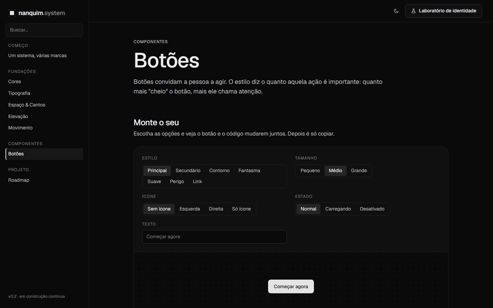
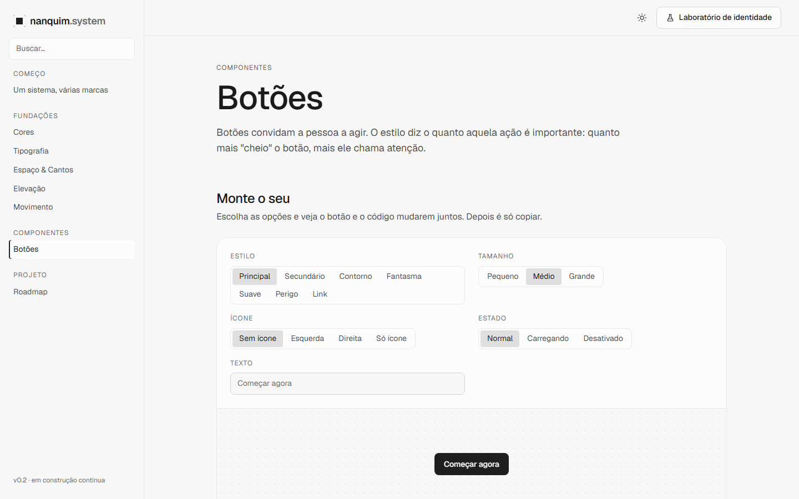

# 003 — Paleta Neutra

**Data:** 2026-10-22 · **Versão:** 0.2 · **Prints:** [`prints/2026-10-22_paleta-neutra/`](prints/2026-10-22_paleta-neutra/)

## Contexto
Durante a escolha da identidade, surgiu o pedido de uma opção **sem cor nenhuma**: só preto, branco e cinzas.
Ela serve como candidata à identidade da casa (combina com o nome Nanquim: tinta preta sobre papel) e como base
sóbria para clientes que ainda não têm marca definida.

## O que foi feito
- Quinta proposta de paleta, `data-theme="neutro"`, com croma zero nos neutros e no destaque.
- Ajuste específico para o modo claro: o destaque inverte de branco para preto.
- Opção "Neutro" no Laboratório e capturas dela nos dois modos no script de prints.
- Correção global: o "texto discreto" do modo claro passou de 4.4 para 4.9 de contraste.

## Decisões (e por quê)
| Decisão | Alternativas consideradas | Motivo |
|---|---|---|
| Regra extra `[data-theme="neutro"][data-mode="light"]` | Mudar a fórmula do destaque para todas as paletas | Só numa paleta sem cor o destaque precisa trocar de lado (branco ↔ preto); nas coloridas a fórmula atual funciona |
| Destaque branco no escuro (L 0.92), não cinza | Cinza médio | Cinza sobre cinza perde hierarquia; o branco mantém o botão principal como o elemento mais forte da tela |

## Problemas encontrados
- **Destaque sem cor sumia no modo claro:** a regra geral escurece o destaque só 0.14, o que deixaria um cinza-claro sobre fundo claro → nessa paleta, o destaque vira quase preto no claro (contraste 15.4).
- **"Texto discreto" com 4.4 no modo claro em todas as paletas:** o problema veio da etapa 001, quando o fundo claro passou a ser levemente cinza, e só apareceu porque o teste agora mede também os textos → passo 9 dos neutros no claro de 0.56 para 0.53.

## Antes / depois
| Neutro, escuro | Neutro, claro |
|---|---|
|  |  |

## Aprendizados
- Uma paleta monocromática é o caso que mais testa o sistema: sem cor, toda a hierarquia depende de luminosidade.
- Rodar o teste de contraste completo a cada mudança pega regressões antigas que passaram despercebidas.

## Próximos passos
- [ ] Escolher a identidade da casa (agora entre 5 propostas)
- [ ] Set de ícones próprio

## Ideia de post
> **"Tirei toda a cor do meu design system para ver se ele aguentava."** Sem cor, quem cria hierarquia é a luz:
> o botão principal vira branco no escuro e preto no claro, e o teste automático ainda achou um texto
> 0.1 abaixo do mínimo de contraste.
> Print sugerido: Neutro escuro × Neutro claro.
