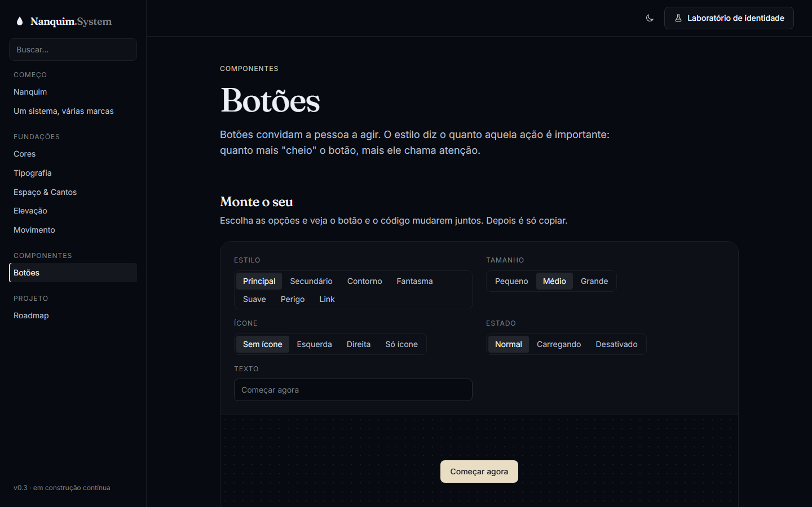
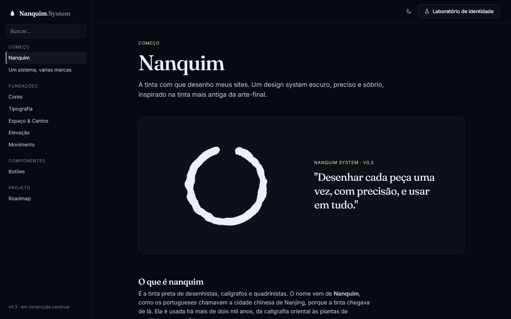

# 004 — Tema Nanquim e página de apresentação

**Data:** 2026-10-22 · **Versão:** 0.3 · **Prints:** [`prints/2026-10-22_tema-nanquim/`](prints/2026-10-22_tema-nanquim/)

## Contexto
Havia 5 propostas de paleta, mas nenhuma representava o nome do projeto. A decisão foi criar uma identidade
que nascesse do próprio nanquim (tinta e papel) e torná-la o padrão. Junto com ela, uma página que conta o
conceito para quem chega, inclusive para quem não é da área.

## O que foi feito
- **Tema Nanquim** (`src/themes/nanquim.css`), agora o padrão da biblioteca e da documentação:
  - **Escuro = tinta:** neutros preto-azulados (matiz 265) e destaque marfim, cor de papel (matiz 85, L 0.9).
  - **Claro = papel:** neutros marfim quentes e destaque preto-azulado, cor de tinta (L 0.30).
  - Os valores padrão saíram de `primitives.css` e passaram a viver no tema: sem `data-theme`, vale o Nanquim.
- **Página "Nanquim"** (`docs/pages/apresentacao.js`), agora a página de abertura da documentação:
  - hero com um ensō que se desenha ao carregar
  - "O que é nanquim", com a origem do nome (Nanquim, como os portugueses chamavam a cidade chinesa de Nanjing)
  - galeria com 4 ilustrações: a gota, o traço, a aguada e o ensō
  - "Por que esse nome": 4 princípios que ligam a tinta às regras do sistema (precisão, contraste, aguada, permanência)
  - "Tinta e papel": os dois modos lado a lado
  - "Aguada": um controle deslizante que "dilui" a tinta pelos 12 tons e mostra a função de cada um
- **Ilustrações geradas em código** (`docs/illustrations.js`): SVG com textura de papel (`feTurbulence`) e borda irregular de tinta (`feDisplacementMap`).
- **Logo:** a marca virou uma gota de tinta, e o texto passou a ser "Nanquim.System".
- **Laboratório:** "Nanquim" é a primeira opção. A chave de armazenamento mudou, então quem já tinha testado outra paleta volta a abrir no Nanquim.
- Captura da página inteira adicionada ao script de prints (`40-apresentacao-completa`).

## Decisões (e por quê)
| Decisão | Alternativas consideradas | Motivo |
|---|---|---|
| Destaque marfim no escuro, e não âmbar ou outra cor | Manter um acento colorido | O conceito é tinta e papel; o "papel sobre a tinta" é a cor mais fiel à metáfora |
| Neutros com leve tom azulado (croma 0.014) | Preto puro (paleta Neutra) | O nanquim real tem um subtom frio; dá profundidade sem virar "azul" |
| Os modos trocam a matiz dos neutros (265 ↔ 85) | Mesma matiz nos dois modos | No claro, cinzas azulados pareceriam frios demais; papel é quente |
| Ilustrações em SVG gerado | Fotos de banco de imagens | Sem licenças nem downloads, leves, originais e coerentes com a paleta; fotos reais podem substituir depois |
| Ensō do hero com `currentColor` | Cor fixa | O traço inverte com o modo: marfim sobre a tinta, tinta sobre o papel |
| Apresentação como página inicial | Manter "Um sistema, várias marcas" | Quem chega primeiro entende o porquê, depois o como |

## Problemas encontrados
- **Tema padrão em dois lugares:** os valores estavam em `primitives.css` e teriam que se repetir no tema → movidos só para `nanquim.css`, com o seletor `:root:not([data-theme])[data-mode="light"]` para o modo claro sem tema explícito.
- **Pincelada com riscos exagerados** → turbulência mais suave (escala 14 para 7).
- **Ponta da pincelada cortada** → a área padrão do filtro SVG cortava a borda deslocada; ampliada para 140%.
- **Versões divergentes (v0.2 no rodapé, v0.3 no hero)** → versão 0.3.0 em todos os lugares.

## Antes / depois
| Antes (Grafite & Âmbar) | Depois (Nanquim) |
|---|---|
|  |  |

Tinta × papel:

| Escuro (tinta) | Claro (papel) |
|---|---|
|  |  |

Página completa: [`40-apresentacao-completa.png`](prints/2026-10-22_tema-nanquim/40-apresentacao-completa.png)

## Aprendizados
- Uma metáfora forte decide muitas coisas sozinha: cor, tipografia, ilustração e até o texto saíram do "tinta e papel".
- Ilustrações em SVG com ruído procedural parecem feitas à mão e pesam quase nada.
- Contraste com folga: o botão principal ficou em 13.4 no escuro e 12.6 no claro.

## Próximos passos
- [ ] Set de ícones próprio, com traço inspirado na pena de nanquim
- [ ] Badges e cards
- [ ] Opcional: trocar as ilustrações por fotos reais de nanquim (próprias ou com licença)

## Ideia de post
> **"Dei ao meu design system o nome de uma tinta, e a tinta acabou desenhando o sistema."**
> Escuro é a tinta, claro é o papel. A escala de 12 tons é uma "aguada". E o contraste é o de preto sobre papel,
> o mais legível que existe.
> Print sugerido: a página completa, ou o par tinta × papel.
