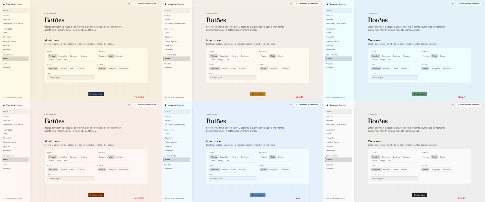
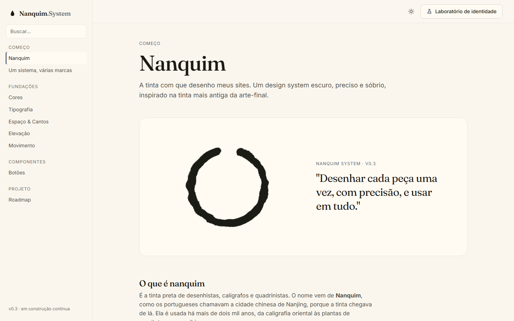
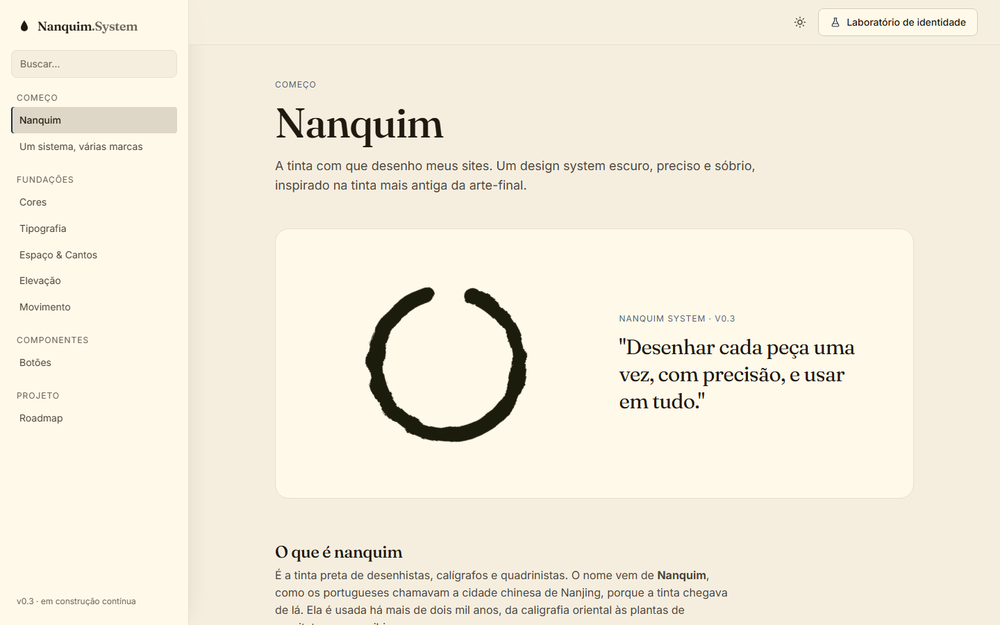
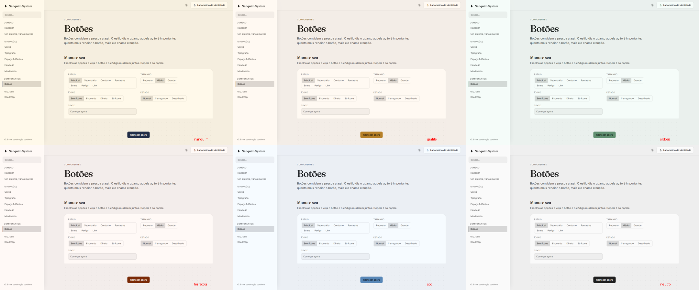
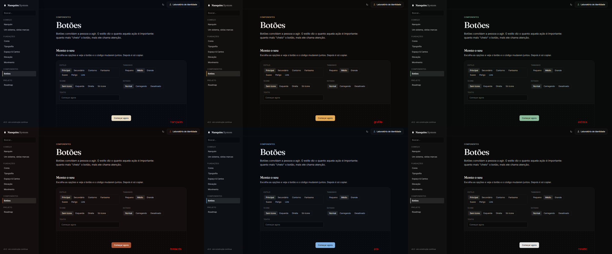

# 005 — Profundidade e modo claro

**Data:** 2026-10-22 · **Versão:** 0.3 · **Prints:** [`prints/2026-10-22_profundidade-modo-claro/`](prints/2026-10-22_profundidade-modo-claro/)

## Contexto
Feedback de uso: "o tema branco está muito branco". No modo claro não dava para perceber a troca de paleta,
e a interface parecia chapada. A sidebar não se separava do conteúdo e as sombras quase não apareciam.

## Diagnóstico (medido, não no olho)
Fundos e superfícies do modo claro antes da correção:

| Paleta | Fundo | Superfície |
|---|---|---|
| Nanquim | `#faf6ee` | `#fffbf3` |
| Grafite | `#f9f6f2` | `#fefbf8` |
| Aço | `#f1f7ff` | `#f6fcff` |
| Neutro | `#f7f7f7` | `#fcfcfc` |

Todas a menos de 4% do branco puro. A causa: o croma dos neutros (0.006 a 0.014) é pensado para o escuro, e perto
do branco a mesma quantidade de cor fica imperceptível.

## O que foi feito
- **`--ds-neutral-tint`**: um multiplicador do croma dos neutros por modo. Vale 1 no escuro e 1.8 no claro. No claro, cada paleta passa a mostrar seu tom (papel, areia, céu, rosado…), e a Neutra continua cinza porque croma 0 × 1.8 = 0.
- **Escala clara mais baixa**: o fundo foi de 0.975 para 0.95 de luminosidade, e toda a escala desceu junto, abrindo distância entre fundo, superfície e bordas.
- **Sombras mais presentes**: a força no claro foi de 0.12 para 0.16, e a linha de luz no escuro de 4% para 6%.
- **Sidebar como camada**:
  - cor de superfície (e não de fundo), com sombra lateral
  - 272px de largura e itens com mais área de clique
  - item ativo em destaque, com fundo mais forte e texto em peso médio

## Decisões (e por quê)
| Decisão | Alternativas consideradas | Motivo |
|---|---|---|
| Multiplicador global `--ds-neutral-tint` | Aumentar o croma em cada paleta | Uma regra só vale para todas as paletas atuais e futuras, inclusive marcas de clientes |
| Multiplicador ×1.8 | ×2.5 (primeiro teste) | Com ×2.5, Ardósia e Aço ficavam azul-piscina e o papel amarelado; ×1.8 mostra a paleta sem saturar |
| Sidebar com superfície + sombra | Só a borda | A borda separa, mas não dá profundidade; a sombra cria a sensação de camada |

## Problemas encontrados
- **Primeira dose forte demais (×2.5)** → visto na grade comparativa das 6 paletas e reduzido para ×1.8.
- **Risco de perder contraste ao escurecer o fundo** → medido em 7 paletas × 2 modos: o menor contraste de texto ficou em 5.0 e o de botão em 4.65 (mínimo exigido: 4.5).

## Antes / depois
Grade comparativa das paletas no modo claro, depois da correção:

| Antes | Depois |
|---|---|
|  |  |

## Aprendizados
- Cor perto do branco (ou do preto) precisa de mais croma para ser percebida: a mesma "quantidade" de cor não tem o mesmo efeito em toda luminosidade.
- Ver todas as paletas lado a lado numa grade revela exageros que uma por uma não mostra.
- Feedback de uso real ("não sinto a mudança") encontra problemas que os testes de contraste não pegam: estava tudo legível, mas sem personalidade.

## Próximos passos
- [ ] Set de ícones próprio
- [ ] Badges e cards

## Ideia de post
> **"Meu modo claro estava legível, mas sem alma."** Todas as paletas viravam o mesmo quase-branco. A correção foi uma
> variável: no claro, os neutros recebem 1.8× mais cor. Agora o papel parece papel, e a troca de marca aparece.
> Print sugerido: a grade com as 6 paletas no modo claro.

## Ajuste fino por paleta (mesmo dia)
Feedback depois da primeira correção: "Ardósia muito forte e azul, sendo que a paleta não tem azul; Carvão e Noite
com o fundo forte demais".

- **Cada paleta define a própria dose:** `--ds-neutral-tint` passou a ler `--ds-neutral-tint-light` do tema (o padrão continua 1.8). Terracota usa 0.9 e Aço usa 0.7.
- **Ardósia sem azul:** o neutro saiu da matiz 230 (cinza-azulado, a pedra ardósia) e foi para 165 (cinza-esverdeado), alinhado ao destaque sálvia. O croma caiu de 0.01 para 0.007, com dose 1.2 no claro.

| Paleta | Fundo claro antes | Depois |
|---|---|---|
| Ardósia | azulado (`#def2fc` medido na dose 2.5) | `#eaf0ed` (cinza-esverdeado) |
| Terracota | `#fbeae5` | `#f3edeb` |
| Aço | `#e1f0ff` | `#ebeff4` |

Contraste depois do ajuste: texto ≥ 5.03 e botões ≥ 4.73 nas três paletas, nos dois modos.

**Aprendizado:** um multiplicador único não serve para todas as matizes. Azuis e vermelhos parecem mais saturados que
amarelos com o mesmo croma, então cada paleta precisa de uma dose própria. E o neutro deve conversar com o destaque:
cinza-azulado com destaque verde "briga".

