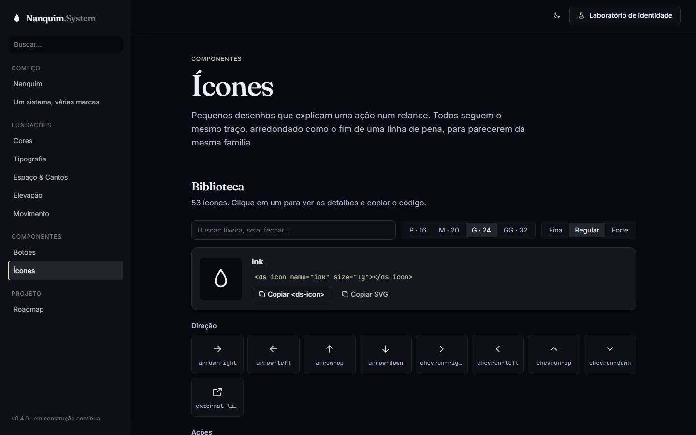
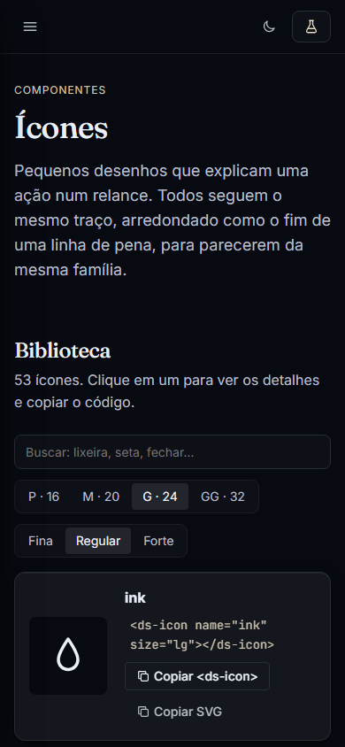

# 006 — Ícones e o primeiro Web Component

**Data:** 2026-10-22 · **Versão:** 0.4.0 · **Prints:** [`prints/2026-10-22_icones/`](prints/2026-10-22_icones/)

## Contexto
Botões, cards e menus dependem de ícones, e até aqui a documentação usava um punhado provisório. Era hora de um set
próprio, com traço coerente com o conceito Nanquim, e de uma forma de usar ícones em qualquer projeto, com ou sem framework.

## O que foi feito
- **53 ícones** em 7 categorias (direção, ações, interface, comunicação, status, mídia e compra, marca), numa fonte única: `src/icons/icons.js`.
- **Regras do traço:** grade 24×24, margem de 2, traço de 1.75, pontas e junções arredondadas (o fim de uma linha de pena). Dois ícones da marca: `ink` (gota) e `pen` (pena).
- **`<ds-icon>`**, o primeiro Web Component do sistema (`src/components/icon/`):
  - `name`, `size` (sm 16, md 20, lg 24, xl 32, vindos da escala de espaço) e `weight` (fina 1.25, regular 1.75, forte 2.25)
  - sem `label`, é decorativo (`aria-hidden`); com `label`, vira `role="img"` com `aria-label`
  - dentro de `.ds-btn`, ajusta-se sozinho ao tamanho do texto
- **`src/index.js`**: ponto de entrada dos componentes interativos (`<script type="module" src="nanquim/src/index.js">`).
- **Página "Ícones"**:
  - biblioteca com busca em português ("lixeira" encontra `trash`), seletor de tamanho e espessura
  - painel fixo com o ícone selecionado e botões para copiar `<ds-icon>` ou o SVG puro (para quem não usa JS)
  - "anatomia do traço" desenhada sobre a grade, matriz de tamanhos × espessuras, uso em botões, faça/evite
- Os botões passaram a usar o set novo, e o conjunto provisório (`docs/icons.js`) foi removido.
- Correções na documentação: espaço entre demonstração e "faça/evite", e ligaduras desligadas nos blocos de código (`<!--` virava uma seta).

## Decisões (e por quê)
| Decisão | Alternativas consideradas | Motivo |
|---|---|---|
| Web Component `<ds-icon>` | Sprite SVG (`<use href>`), fonte de ícones | Funciona em qualquer HTML ou framework, aceita atributos e é acessível por padrão; fontes de ícone têm problemas de nitidez e acessibilidade |
| Copiar SVG puro na documentação | Exigir JavaScript | Quem não usa JS (WordPress, e-mail) também consegue usar |
| Espessura via CSS (`--icon-stroke`) | Um arquivo por espessura | Um único desenho serve às 3 espessuras e a qualquer valor futuro |
| Ícones só de contorno, sem preenchidos | Versões sólidas | Coerência com o traço de pena; preenchidos podem vir depois como variante |
| Palavras-chave em português | Só os nomes em inglês | Quem busca "lixeira" ou "fechar" precisa encontrar o ícone, mesmo sem saber o nome técnico |

## Problemas encontrados
- **Legenda da matriz de tamanhos desalinhada** → refeita como grade CSS, com linhas por espessura e colunas por tamanho.
- **`<!--` aparecia como seta nos exemplos** → a JetBrains Mono junta esses caracteres numa ligadura; desligada com `font-variant-ligatures: none`.
- **"Faça/evite" colado na demonstração** → regra de espaço para `.doc-demo` seguida de bloco.

## Antes / depois
| Biblioteca de ícones | No celular |
|---|---|
|  |  |

## Aprendizados
- Um Web Component pequeno (cerca de 30 linhas) já entrega o principal: uso declarativo, atributos reativos e acessibilidade correta por padrão.
- Busca por sinônimos no idioma de quem usa vale mais que nomes técnicos perfeitos.
- Revisar a página inteira em captura alta pega problemas de alinhamento que o topo da página não mostra.

## Próximos passos
- [ ] Badges e cards (v0.5.0)
- [ ] Campos de formulário
- [ ] Carrossel e slides

## Ideia de post
> **"53 ícones, um traço só."** Desenhei o set de ícones do Nanquim System com uma regra: o traço tem que parecer o fim
> de uma linha de pena de nanquim. Funciona em qualquer site com `<ds-icon name="heart">`, e quem procura "lixeira"
> encontra o ícone certo.
> Print sugerido: a biblioteca com o painel do ícone selecionado.
