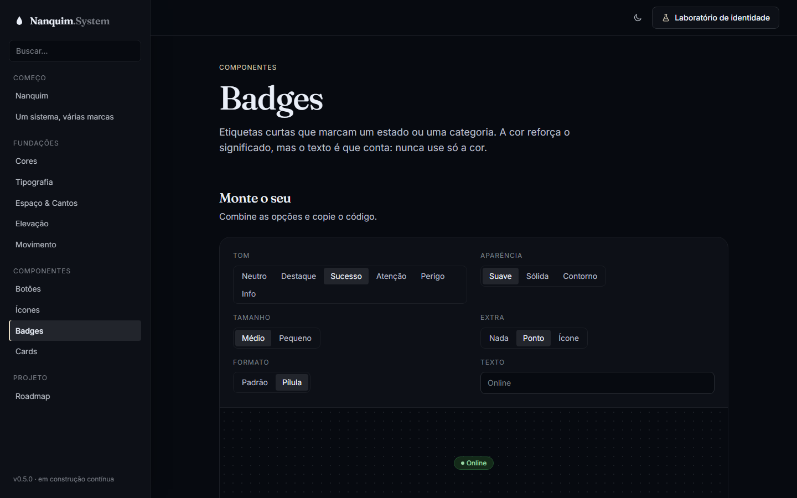
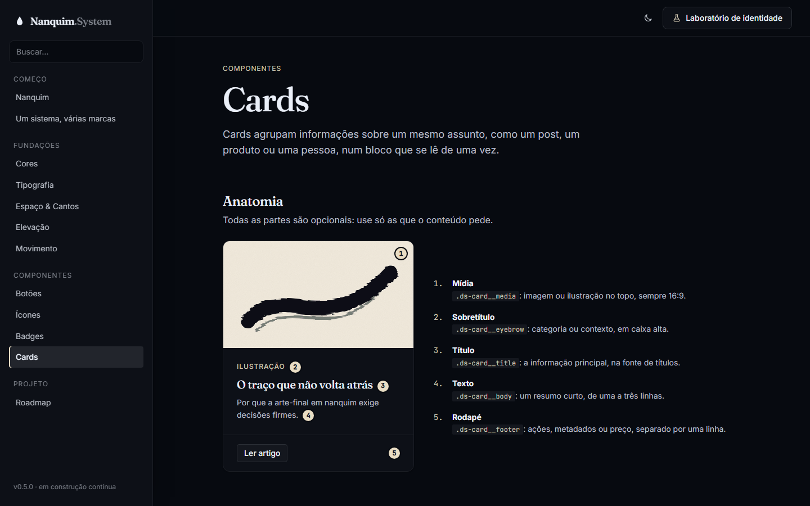
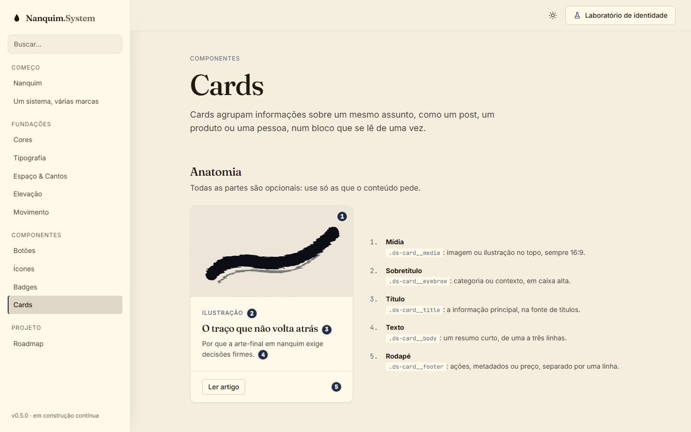

# 007 — Badges e cards

**Data:** 2026-10-22 · **Versão:** 0.5.0 · **Prints:** [`prints/2026-10-22_badges-cards/`](prints/2026-10-22_badges-cards/)

## Contexto
Com botões e ícones prontos, faltavam as peças que **juntam** outras peças. O card é o primeiro bloco composto do
sistema: usa ícones, badges e botões ao mesmo tempo. A partir daqui, o Nanquim começa a montar trechos reais de site.

## O que foi feito
- **Badge (`ds-badge`)**, em CSS puro:
  - 6 tons com significado fixo: neutro, destaque, sucesso, atenção, perigo e info
  - 3 aparências (suave, sólida, contorno), 2 tamanhos, formato pílula
  - ponto de status (`--dot`) e ícones (`<ds-icon>`) dentro
- **Card (`ds-card`)**, em CSS puro:
  - anatomia com partes opcionais: `__media` (16:9), `__content`, `__eyebrow`, `__title`, `__body`, `__footer`
  - 4 variantes (padrão, elevado, contorno, interativo), layout horizontal e versão compacta
  - o interativo é um `<a>` inteiro, que levanta e aproxima a imagem ao passar o mouse, com foco visível
- **Tokens novos:** `--ds-color-on-success`, `--ds-color-on-warning` e `--ds-color-on-info`, para o texto sobre status sólidos.
- **Página "Badges":** playground (tom, aparência, tamanho, extra, formato, texto), matriz tons × aparências com o "quando usar" de cada tom e exemplos em tabela de pedidos e em tags.
- **Página "Cards":** anatomia numerada, playground (variante, imagem, layout, rodapé), as 4 variantes e 5 exemplos de sites reais: post de blog, produto, plano de assinatura, perfil de equipe e indicadores.

## Decisões (e por quê)
| Decisão | Alternativas consideradas | Motivo |
|---|---|---|
| Tons via variáveis internas (`--tone-soft`, `--tone-solid`…) e aparência separada | Uma classe para cada combinação (18) | 6 + 3 classes geram as 18 combinações; um tom novo custa um bloco de 5 linhas |
| Card como CSS com classes BEM (`ds-card__title`) | Web Component `<ds-card>` | O card não tem comportamento; HTML semântico (`article`, `a`, `h3`) é mais acessível e flexível |
| Card interativo é o próprio `<a>` | Botão "ver mais" dentro do card | A área de clique é o card inteiro, e o leitor de tela anuncia um único link |
| Texto escuro sobre sucesso, atenção e info sólidos | Texto branco em todos | Esses tons são claros (L 0.66 a 0.80); só o perigo (L 0.56) comporta texto claro |
| Exemplos de uso com conteúdo realista | Lorem ipsum | Mostra para cliente e para leigo como a peça fica num site de verdade |

## Problemas encontrados
- **Títulos dos cards pequenos e na fonte errada:** o estilo genérico da documentação (`.doc-section h3`) vencia o do componente por especificidade → restringido a `h3` sem classe `ds-`. É a primeira vez que um componente da biblioteca colidiu com a documentação.
- **Ilustrações com faixas laterais na mídia 16:9:** SVG em linha não recorta como `object-fit` → `preserveAspectRatio="xMidYMid slice"` nas ilustrações.
- **Marcador "1" invisível sobre o papel** (marfim sobre marfim) → anel com a cor do fundo ao redor dos marcadores.
- **Valores fora da escala no badge** (11px e 6px) → trocados por `--ds-text-xs` e `0.5em`.

## Antes / depois
| Badges | Cards |
|---|---|
|  |  |

Cards no modo papel:

## Aprendizados
- O contraste dos badges foi medido em 252 combinações (6 tons × 3 aparências × 7 paletas × 2 modos): nenhuma abaixo de 4.5, e a menor ficou em 4.65.
- Componentes compostos expõem conflitos de especificidade que componentes isolados escondem; estilos de documentação precisam ser bem delimitados.
- Exemplos realistas (preço, pedido, perfil) são a melhor "venda" do sistema para quem não é técnico.

## Próximos passos
- [ ] Campos de formulário (v0.6.0)
- [ ] Carrossel e slides

## Ideia de post
> **"Um card de blog, um de produto e um de preço com as mesmas 6 classes."** Com badges e cards, o Nanquim System
> começou a montar pedaços de site de verdade. Testei o contraste das etiquetas em 252 combinações e nenhuma ficou
> ilegível.
> Print sugerido: a grade de exemplos de uso.
