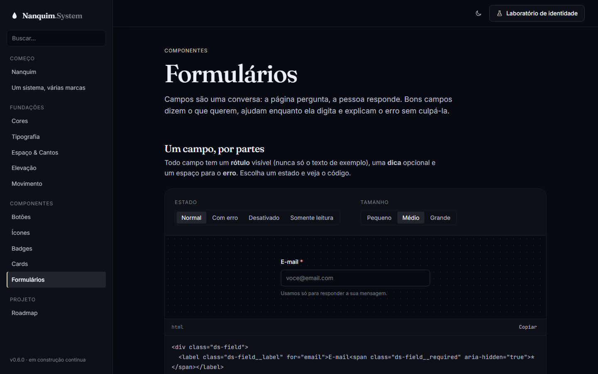
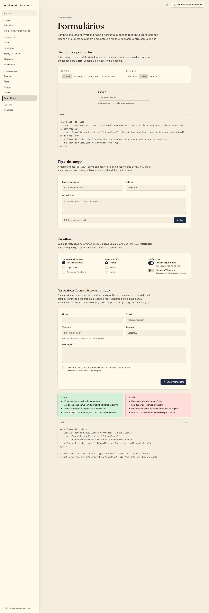

# 008 — Formulários

**Data:** 2026-10-23 · **Versão:** 0.6.0 · **Prints:** [`prints/2026-10-23_formularios/`](prints/2026-10-23_formularios/)

## Contexto
Todo site de cliente tem pelo menos um formulário: contato, orçamento, newsletter. Até aqui o Nanquim não tinha
nenhum campo. Esta etapa traz as peças de entrada de dados e um formulário de contato completo, no formato que uso em sites reais.

## O que foi feito
- **`ds-field`:** envelope do campo, com `__label`, `__required` (asterisco), `__hint` e `__error` (que some quando está vazio).
- **`ds-input`:** a mesma classe para `input`, `textarea` e `select`:
  - 3 tamanhos com a mesma altura dos botões (32, 40, 48), para campo e botão alinharem lado a lado
  - ícone dentro do campo (`ds-input-icon`) e seleção com seta própria (`ds-select`)
  - estados: foco, erro (`aria-invalid="true"`), desativado e somente leitura
- **`ds-check`** (checkbox e radio) e **`ds-switch`** (interruptor), com animação de mola e texto de apoio (`ds-check__text`).
- **`ds-fieldset`** para agrupar escolhas com `legend`.
- **Token novo:** `--ds-focus-ring-danger`, o anel de foco vermelho dos campos com erro.
- **Página "Formulários":**
  - campo "por partes" com seletor de estado e tamanho, com código ao vivo
  - tipos de campo: busca com ícone, seleção, área de texto, e-mail + botão na mesma linha
  - escolhas: serviços (checkbox), horário (radio), notificações (switch)
  - **formulário de contato funcional:** validação no envio, foco no primeiro erro, mensagens anunciadas por leitores de tela, correção enquanto digita e consentimento LGPD obrigatório e desmarcado

## Decisões (e por quê)
| Decisão | Alternativas consideradas | Motivo |
|---|---|---|
| Estilizar os elementos nativos (`appearance: none`) | Recriar checkbox e select com `div` e JS | O nativo já funciona com teclado, leitor de tela, autocompletar e o teclado certo no celular |
| Erro via `aria-invalid` + `aria-describedby` | Classe `.is-error` | O mesmo atributo pinta o campo e avisa o leitor de tela |
| Validar só depois do primeiro envio, e então a cada digitação | Validar ao sair de cada campo | Não acusa erro de quem ainda está digitando; depois do envio, dá retorno imediato da correção |
| Check e seta do select via `mask` com SVG | Ícones como imagem | A cor vem dos tokens (`background: currentColor`), então funciona em qualquer paleta e modo |
| Biblioteca só com CSS; a validação fica no exemplo | Componente `<ds-form>` | A regra de validação muda de site para site; o exemplo mostra o padrão sem prender ninguém |

## Problemas encontrados
- **Valores fora da escala no interruptor** (3px, 2px, 1px) → posições calculadas a partir de `--ds-space-1`, com a borda descontada.
- **Anel de foco vermelho escrito à mão** → virou token (`--ds-focus-ring-danger`), irmão do `--ds-focus-ring`.
- **Escape desnecessário na mensagem de sucesso:** `textContent` já é seguro, e escapar faria "&" aparecer como `&amp;` → removido.

## Antes / depois
| Formulário (tinta) | Formulário (papel) |
|---|---|
|  |  |

Página completa: [`41-formularios-completo.png`](prints/2026-10-23_formularios/41-formularios-completo.png)

## Aprendizados
- Contraste medido em 7 paletas × 2 modos para texto digitado, rótulo, placeholder, dica, erro, marca do checkbox e interruptor. O menor valor de texto foi 4.79 (dica) e o de gráfico 4.65 (marca do checkbox).
- Formulário bom é comportamento, não só visual: ordem do foco, quando mostrar o erro e o que a mensagem diz pesam mais que a cor da borda.
- Elementos nativos estilizados entregam acessibilidade "de graça", algo que componentes recriados do zero raramente conseguem.

## Próximos passos
- [ ] Carrossel e slides (v0.7.0), os primeiros Web Components com comportamento
- [ ] Modal, gaveta e tooltip

## Ideia de post
> **"O formulário de contato que não culpa quem está preenchendo."** No Nanquim System, o erro só aparece depois de
> enviar, diz como corrigir ("como nome@site.com") e some enquanto você digita. Tudo com elementos nativos do HTML,
> então teclado, leitor de tela e celular funcionam sem nenhum código extra.
> Print sugerido: o formulário com os erros visíveis.
