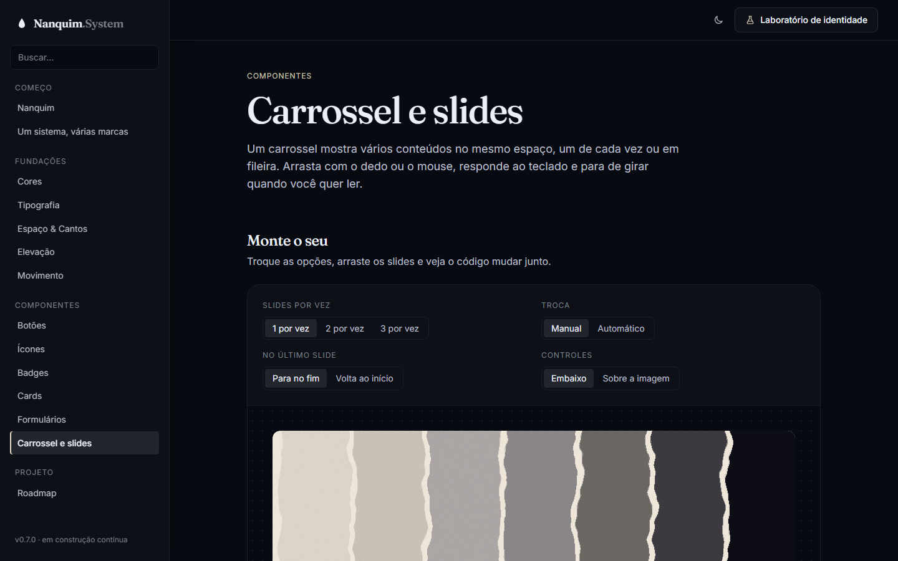
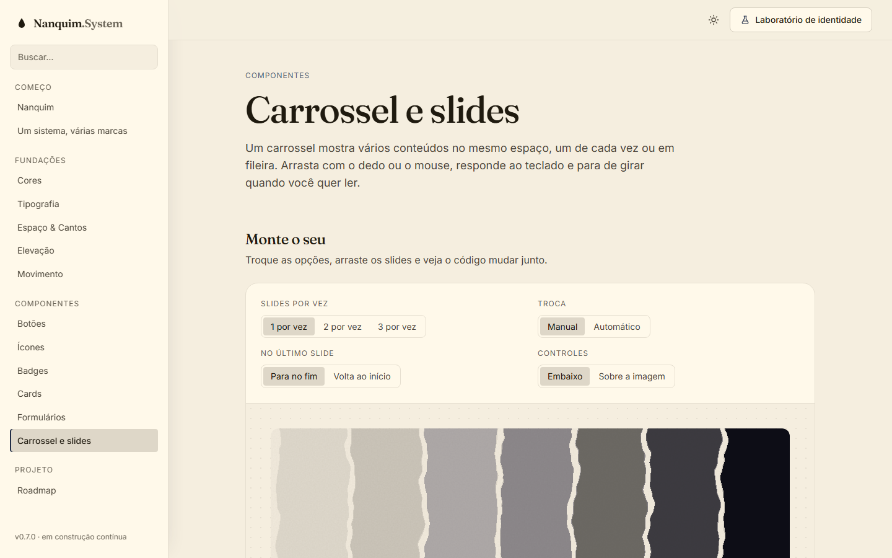

# 009 — Carrossel e slides

**Data:** 2026-10-23 · **Versão:** 0.7.0 · **Prints:** [`prints/2026-10-23_carrossel/`](prints/2026-10-23_carrossel/)

## Contexto
Banner de destaque no topo, fileira de posts, depoimentos de clientes, galeria de fotos: quase todo site de cliente
tem pelo menos um carrossel. Também é o primeiro componente do Nanquim que precisa de **comportamento**, não só de visual.
O `<ds-icon>` só desenhava um SVG; o `<ds-carousel>` arrasta, conta tempo, responde ao teclado e conversa com leitores de tela.

## O que foi feito
- **`<ds-carousel>`:** o HTML é só um trilho com os slides dentro (`.ds-carousel__track`). O componente cria sozinho:
  - setas (anterior e próximo), que ficam desativadas nas pontas quando não há `loop`
  - indicadores, um por "parada" do carrossel
  - botão de pausa, quando há `autoplay`
- **Atributos:** `label`, `per-view` (quantos por vez), `loop`, `autoplay` (com o intervalo) e `variant="overlay"` (controles por cima da imagem).
- **Arrastar:** no celular, o trilho é uma rolagem nativa com `scroll-snap`; no desktop, o arraste com o mouse é feito em JS e não vira clique quando termina em cima de um link.
- **Teclado:** setas, <kbd>Home</kbd> e <kbd>End</kbd> com o foco no trilho.
- **Autoplay responsável:**
  - pausa ao passar o mouse, no foco do teclado e no botão de pausa
  - não roda para quem pediu movimento reduzido no sistema
  - o indicador ativo vira uma barra que enche no ritmo da troca
- **Página "Carrossel e slides":**
  - playground com 4 opções e código ao vivo
  - banner de destaque com autoplay
  - carrossel de cards (3 por vez)
  - depoimentos (2 por vez, com loop)
  - galeria com controles sobre a imagem
  - tabela de atributos e seção de acessibilidade com as teclas

## Decisões (e por quê)
| Decisão | Alternativas consideradas | Motivo |
|---|---|---|
| Trilho com `scroll-snap` nativo | Mover os slides com `transform` em JS | O toque, a inércia e a rolagem do trackpad vêm do navegador; sem JS, o conteúdo continua acessível como uma lista rolável |
| O fim da animação do indicador ativo dispara a troca | `setInterval` separado da barra de progresso | Barra e troca nunca dessincronizam, e pausar a animação já pausa o carrossel, retomando de onde parou |
| Paradas calculadas pelo fim da rolagem | Um indicador por slide | Com 3 cards por vez, os últimos slides não viram "primeiro"; os indicadores mostram só as posições reais |
| Slides fora da tela com `inert` | Só esconder visualmente | O <kbd>Tab</kbd> não cai num link invisível, e o leitor de tela lê só o que está na tela |
| `aria-live` desligado enquanto gira sozinho | Anunciar toda troca | Anunciar a cada 6 segundos atrapalharia quem usa leitor de tela; com a troca pausada, o slide novo é anunciado |
| Configuração por atributos | Opções em JavaScript | Quem monta a página escreve só HTML, igual aos outros componentes |

## Problemas encontrados
- **Indicadores apagados demais:** a cor de borda forte media 2.1:1 a 2.6:1 contra o fundo, abaixo do mínimo de 3:1 para elementos de interface → trocados para `text-subtle` (menor valor medido: 4.53, em 7 paletas × 2 modos).
- **Pausa invertida:** `toggleAttribute(nome, undefined)` *alterna* em vez de desligar, e o carrossel começava marcado como pausado → estados iniciados como `false`.
- **Slides do meio do caminho:** ao pular do primeiro para o quarto, a rolagem passava pelo segundo e pelo terceiro e os indicadores piscavam → durante uma rolagem pedida por botão, o slide de destino fica travado até chegar.
- **Margem padrão de `<figure>`** quebrava a conta de largura dos slides → o trilho zera a margem dos filhos.
- **Sombra cortada:** o card que levanta no hover era cortado pela rolagem do trilho → respiro vertical no exemplo.

## Antes / depois
| Carrossel (tinta) | Carrossel (papel) |
|---|---|
|  |  |

Página completa: [`43-carrossel-completo.png`](prints/2026-10-23_carrossel/43-carrossel-completo.png) · celular: [`36-mobile-carrossel.png`](prints/2026-10-23_carrossel/36-mobile-carrossel.png)

## Aprendizados
- Um carrossel acessível é quase todo sobre **parar**: pausar no hover, no foco, no botão e para quem pediu menos movimento.
- Usar o que o navegador já faz (rolagem, snap, toque) deixou o JavaScript do componente com menos de 300 linhas e sem dependências.
- Testar com arraste de mouse de verdade: eventos sintéticos não "capturam" o ponteiro, então o teste automático não pegaria um erro no arraste.

## Próximos passos
- [ ] Modal, gaveta e tooltip (v0.8.0)
- [ ] Seções de site: hero, navbar, rodapé, preços, depoimentos

## Ideia de post
> **"O carrossel que sabe parar."** Carrossel que gira sozinho é um dos padrões mais criticados da web: o texto some
> antes de você terminar de ler. O do Nanquim System pausa quando o mouse chega, quando o teclado entra e para quem
> pediu menos movimento no sistema. A barrinha do indicador mostra quanto falta para trocar.
> Print sugerido: o banner de destaque com a barra de progresso.
