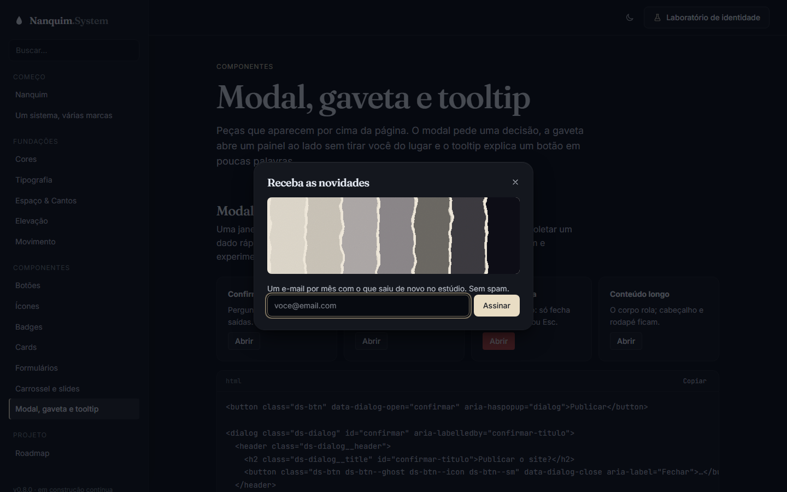
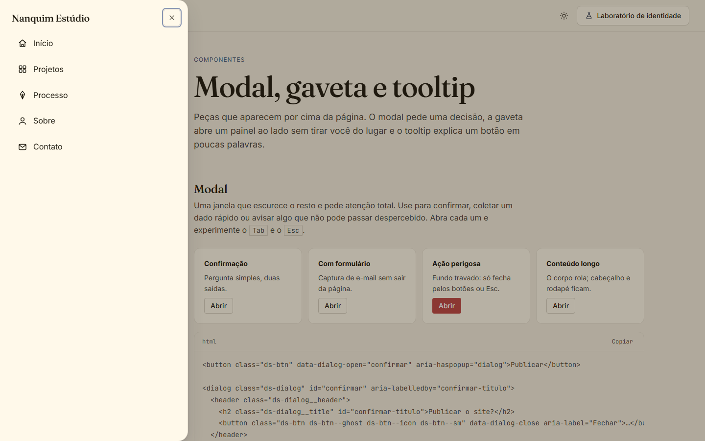

# 010 — Modal, gaveta e tooltip

**Data:** 2026-10-23 · **Versão:** 0.8.0 · **Prints:** [`prints/2026-10-23_sobreposicoes/`](prints/2026-10-23_sobreposicoes/)

## Contexto
Depois do carrossel, faltavam as peças que aparecem **por cima** da página: o modal que pede uma decisão,
a gaveta do menu do celular e do carrinho, e o tooltip que dá nome a botões de ícone. São componentes famosos
por darem errado em acessibilidade: foco que escapa, página que rola por trás, balão que some antes de ser lido.

## O que foi feito
- **Modal (`ds-dialog`):** sobre o elemento nativo `<dialog>`, com cabeçalho, título, corpo que rola e rodapé.
  - tamanhos `--sm` e `--lg`
  - abre com `data-dialog-open="id"` e fecha com `data-dialog-close`, sem escrever JavaScript na página
  - fecha no clique fora; `data-static` desliga isso para ações perigosas
  - a página por trás para de rolar enquanto ele está aberto
- **Gaveta:** o mesmo componente preso a um lado, com `--drawer` (direita), `--start` (esquerda) e `--bottom` (de baixo, como nos apps).
- **Tooltip (`<ds-tooltip>`):** balão de texto curto em 4 posições.
  - abre com o mouse e com o teclado, fecha com <kbd>Esc</kbd>
  - o mouse pode passar para cima do balão sem ele sumir
  - vira para o lado oposto quando não cabe na tela
- **Token novo:** `--ds-color-overlay`, o fundo escurecido atrás do modal (tinta no escuro, sombra quente no papel).
- **Página "Modal, gaveta e tooltip":** 4 modais (confirmação, formulário, ação perigosa, conteúdo longo), 3 gavetas (menu, carrinho, filtros), posições do tooltip, uma barra de ferramentas e a seção de acessibilidade.

## Decisões (e por quê)
| Decisão | Alternativas consideradas | Motivo |
|---|---|---|
| `<dialog>` nativo com `showModal()` | Modal feito com `div` e JS | Foco preso, <kbd>Esc</kbd>, página por trás inerte e foco que volta ao botão já vêm do navegador; recriar isso é onde a maioria dos modais erra |
| Abrir e fechar por atributos (`data-dialog-open`) | Um Web Component `<ds-modal>` | O HTML continua sendo um `<dialog>` comum, que funciona em qualquer framework; o script só liga os botões |
| Gaveta como variante do modal | Componente separado | É o mesmo comportamento com outra posição; uma peça a menos para manter |
| Animação de entrada com `@starting-style` | Classes de animação controladas por JS | Puro CSS; navegador sem suporte só abre sem animar |
| Rolagem travada com `html:has(.ds-dialog:modal)` | JS mexendo no `overflow` do `body` | Uma regra de CSS, sem estado para esquecer de desfazer |
| Tooltip não repete o `aria-label` | Sempre ligar com `aria-describedby` | Num botão de ícone, o leitor de tela leria "Excluir, Excluir" |

## Problemas encontrados
- **Página rolando para o lado:** o balão do tooltip fechado estava só invisível (`visibility: hidden`) e ainda ocupava espaço; um balão perto da borda empurrava a página 196px → fechado agora é `display: none`, e a animação de entrada usa `@starting-style`.
- **Gaveta de baixo ocupando a tela toda:** com `inset: 0`, `height: auto` estica até as bordas → `height: fit-content`.
- **Regra de abertura do tooltip perdendo para a de posição** (mesma especificidade, declarada antes) → o deslocamento da entrada virou variável (`--tooltip-enter`), e o estado aberto só zera o valor.
- **Foco inicial no botão de fechar** no modal de newsletter → `autofocus` no campo de e-mail, e a documentação explica como escolher.

## Antes / depois
| Modal (tinta) | Gaveta (papel) |
|---|---|
|  |  |

Carrinho: [`46-gaveta-carrinho.png`](prints/2026-10-23_sobreposicoes/46-gaveta-carrinho.png) · filtros no celular: [`37-mobile-gaveta-filtros.png`](prints/2026-10-23_sobreposicoes/37-mobile-gaveta-filtros.png) · página completa: [`48-sobreposicoes-completo.png`](prints/2026-10-23_sobreposicoes/48-sobreposicoes-completo.png)

## Aprendizados
- O HTML já tem um modal acessível pronto. O trabalho de um design system aqui é vestir o `<dialog>`, não reinventá-lo.
- Elemento escondido com `visibility` continua no layout. Para algo posicionado fora do fluxo, `display: none` é mais seguro.
- Contraste medido em 7 paletas × 2 modos: texto do modal ≥ 9.19:1, título ≥ 15.41:1, tooltip ≥ 14.85:1.

## Próximos passos
- [ ] Seções de site: hero, navbar, rodapé, preços, depoimentos (v0.9.0)
- [ ] Brandizar um site de cliente real só com o Nanquim

## Ideia de post
> **"O melhor modal é o que o navegador já fez."** O `<dialog>` do HTML prende o foco, fecha com Esc e devolve o
> foco ao botão que abriu, tudo sem uma linha de JavaScript. No Nanquim System, o modal e a gaveta são esse elemento
> nativo vestido com os tokens da marca, e abrem só com um atributo no botão.
> Print sugerido: a gaveta do carrinho aberta.
