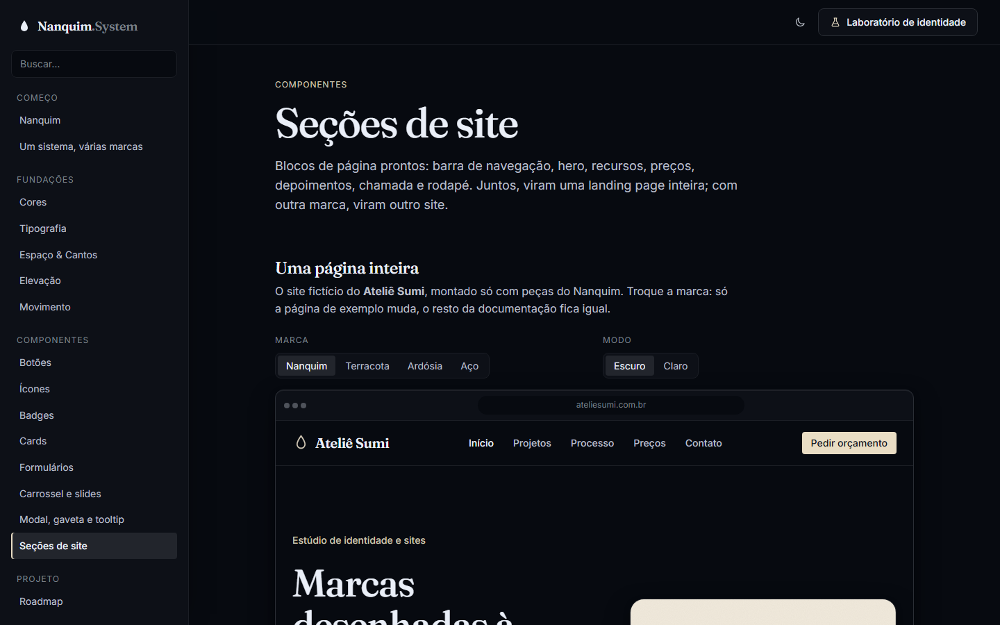
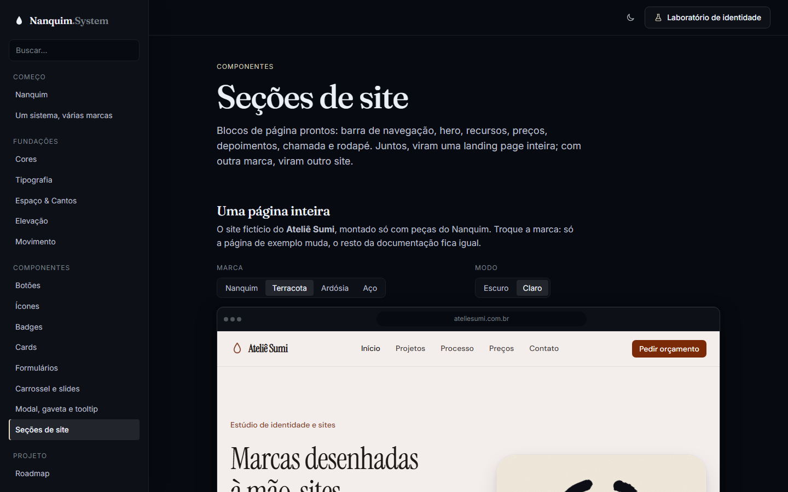

# 011 — Seções de site

**Data:** 2026-10-23 · **Versão:** 0.9.0 · **Prints:** [`prints/2026-10-23_secoes/`](prints/2026-10-23_secoes/)

## Contexto
Até aqui o Nanquim tinha peças soltas: botão, card, campo, carrossel, modal. Um site de cliente, porém, é feito de
**blocos de página**: o menu do topo, a primeira dobra, a seção de serviços, os preços, os depoimentos e o rodapé.
Esta etapa monta esses blocos com as peças que já existiam e, pela primeira vez, mostra uma landing page inteira
feita só com o sistema.

## O que foi feito
- **Base de layout:** `ds-container` (largura máxima e respiro lateral), `ds-section` (com `--alt` para alternar o fundo), cabeçalho de seção (`__eyebrow`, `__title`, `__lead`) e `ds-grid`, uma grade que se ajusta sozinha a partir de uma largura mínima (`--grid-min`).
- **Barra de navegação (`ds-navbar`):** marca, links, ação principal e versão fixa no topo (`--sticky`). Em larguras estreitas, os links viram um botão que abre a gaveta da v0.8.0.
- **Hero (`ds-hero`):** texto e imagem lado a lado, ou centralizado (`--center`). O título cresce e diminui com a largura da seção.
- **Recursos (`ds-feature`), preços (`ds-plan`), depoimentos (`ds-testimonial`), chamada (`ds-cta`) e rodapé (`ds-footer`).**
- **Botão de alternar:** `ds-btn[aria-pressed="true"]`, usado no "Mensal / Anual" dos preços.
- **Página "Seções de site":**
  - landing page do Ateliê Sumi, um cliente fictício, dentro de uma moldura de navegador, com troca de marca (Nanquim, Terracota, Ardósia, Aço) e de modo **só no exemplo**
  - a mesma página em largura de celular, com o menu abrindo a gaveta
  - o código de cada peça

## Decisões (e por quê)
| Decisão | Alternativas consideradas | Motivo |
|---|---|---|
| Seções respondem à **própria largura** (container queries) | Media queries pela largura da janela | A mesma seção funciona numa página inteira, numa coluna estreita ou numa prévia; a documentação mostra a versão de celular sem precisar de um celular |
| Preços com `subgrid` | Altura mínima fixa na descrição | Preços, listas e botões ficam na mesma linha entre os cards, qualquer que seja o texto |
| Raios recalculados em qualquer `[data-radius]` | Raio calculado só no `:root` | Junto com cor, fonte e modo, uma seção (ou um site dentro da documentação) pode vestir outra marca sem afetar o resto |
| Classes de seção em vez de Web Components | `<ds-hero>`, `<ds-navbar>` | São blocos de conteúdo, sem comportamento próprio; o único comportamento (o menu) reaproveita o `<dialog>` |
| Itens que o plano não inclui com `aria-disabled` e risco | Esconder os itens | Comparar planos fica mais fácil, e o leitor de tela também sabe que o item não está incluído |

## Problemas encontrados
- **Container que consulta a si mesmo:** o espaçamento da `ds-section` estava dentro de uma regra `@container`, mas um container só responde para os filhos → virou `clamp()`.
- **Preços desalinhados:** descrições de tamanhos diferentes empurravam o preço para baixo em um dos cards → `subgrid`.
- **Recursos quebrando em 3 + 1:** a largura mínima de 13rem não cabia 4 por linha → 12rem.
- **Marca só pela metade:** cores e fontes mudavam no exemplo, mas os cantos não, porque os raios eram calculados só no `:root` → os raios agora são recalculados em qualquer elemento com `data-radius`.

## Antes / depois
| Nanquim (tinta) | Terracota (papel) |
|---|---|
|  |  |

Landing inteira: [`52-landing-completa.png`](prints/2026-10-23_secoes/52-landing-completa.png) · outras marcas: [`50-secoes-ardosia.png`](prints/2026-10-23_secoes/50-secoes-ardosia.png), [`51-secoes-aco-claro.png`](prints/2026-10-23_secoes/51-secoes-aco-claro.png) · celular: [`38-mobile-secoes.png`](prints/2026-10-23_secoes/38-mobile-secoes.png)

## Aprendizados
- Com tokens em camadas, "rebrandizar um site" vira trocar quatro atributos num elemento. Foi a primeira vez que isso apareceu numa página inteira, e não só num botão.
- Container queries mudam a forma de pensar o responsivo: a seção não pergunta "qual é a tela?", pergunta "quanto espaço eu tenho?".
- Quase nada de CSS novo foi preciso para as seções: elas reaproveitam botões, badges, ícones e a gaveta. Esse é o sinal de que as peças anteriores estavam no tamanho certo.

## Próximos passos
- [ ] Pacote para usar em outros projetos (npm e CDN)
- [ ] Primeiro site de cliente feito só com o Nanquim

## Ideia de post
> **"Um site, quatro marcas."** No Nanquim System, a mesma landing page vira outro site trocando quatro atributos:
> cor, fonte, cantos e modo. Nenhuma linha de CSS reescrita. E cada seção se ajusta à largura que tem, não à da
> tela, então o mesmo bloco funciona no celular, numa coluna ou dentro de outra página.
> Print sugerido: lado a lado, Nanquim (tinta) e Terracota (papel).
