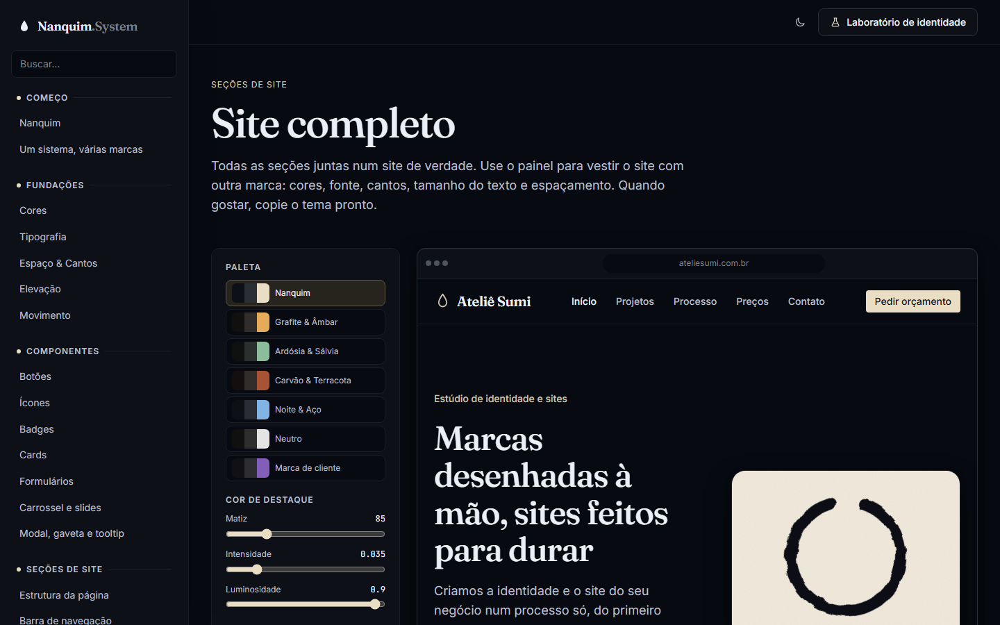
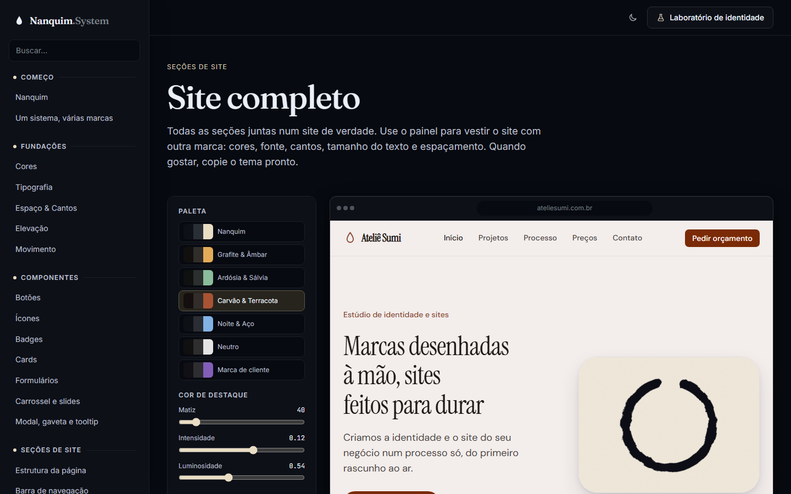

# 012 — Seções separadas e visualizador de marca

**Data:** 2026-10-23 · **Versão:** 0.10.0 · **Prints:** [`prints/2026-10-23_secoes-separadas/`](prints/2026-10-23_secoes-separadas/)

## Contexto
Na v0.9.0, todas as seções de site estavam numa página só. Ao revisar, pedi três mudanças:
- "Seções de site" virar um **grupo do menu**, como Começo, Fundações e Componentes, com uma página por elemento;
- um **destaque discreto** nas cabeças desses grupos;
- no fim do grupo, o site completo com um painel **parecido com o Laboratório**, mas que muda também cantos, fonte e tamanhos, para servir de visualizador de verdade.

## O que foi feito
- **Grupo "Seções de site"** com 10 páginas:
  - estrutura da página, barra de navegação, hero, recursos, preços, depoimentos
  - **perguntas frequentes** (novo), chamada para ação e rodapé
  - **site completo**, por último
- **Cabeças de grupo no menu:** uma gota na cor de destaque, rótulo mais firme e um fio fino até a borda.
- **Prévias com largura:** toda prévia de seção tem "Computador / Tablet / Celular". A seção se reorganiza na hora, e o menu de celular abre a gaveta de verdade.
- **Perguntas frequentes (`ds-faq`):** feitas com `
` e `
` do HTML. O "+" gira e vira "×" ao abrir.
- **Visualizador no "Site completo":**
  - paleta pronta ou cor própria: matiz, intensidade e luminosidade do destaque, matiz e cor dos neutros
  - tipografia e tamanho do texto (85% a 125%)
  - cantos (de 0 a 20px) e espaçamento (75% a 130%)
  - modo claro/escuro e largura da prévia
  - **contraste medido ao vivo** (texto, texto suave, botão principal, destaque)
  - **tela cheia** e **"Copiar tema"**, que gera o arquivo CSS da marca pronto para usar
- **Tokens novos:** `--ds-text-scale` e `--ds-space-scale`. Espaços e tamanhos de texto são multiplicados por eles e recalculados em qualquer elemento com `data-scale`, como os raios com `data-radius`.

## Decisões (e por quê)
| Decisão | Alternativas consideradas | Motivo |
|---|---|---|
| Uma página por seção, mais o site completo no fim | Uma página única longa | Cada seção ganha "quando usar", anatomia, faça/evite e código próprio; o site completo mostra o conjunto |
| Visualizador aplica tudo **só no site de exemplo** | Mudar a documentação inteira, como o Laboratório | Dá para comparar a marca nova com a da casa lado a lado, e a documentação continua legível com qualquer combinação |
| Escalas de texto e espaço como multiplicadores nos tokens | `zoom` ou `transform: scale` na prévia | Com `zoom`, tudo cresce junto; com o multiplicador, só o texto (ou só o espaço) muda, como aconteceria num site de verdade |
| Cor própria gera também o texto do botão | Deixar a pessoa escolher as duas cores | Com destaque claro, o texto do botão fica escuro, e vice-versa; o contraste ao lado confirma |
| "Copiar tema" gera o CSS da marca | Copiar só os atributos do `<html>` | O resultado do visualizador vira um arquivo de tema real, igual ao `_marca-exemplo.css` |
| Perguntas frequentes com `
` | Acordeão em JavaScript | Teclado, leitor de tela e busca do navegador funcionam sem código |

## Problemas encontrados
- **Nomes das paletas cortados** ("Na...", "Gra...") no painel de duas colunas → as paletas ficaram em uma coluna, com o nome inteiro.
- **Variáveis lidas como `calc(...)`:** ao trocar os espaços para multiplicadores, conferi se alguma página da documentação exibia o valor cru do token. Nenhuma exibia.
- **Primeira versão com dois dígitos (v0.10.0):** conferi se as faixas da linha do tempo ordenam por número, não por texto. Senão, a v0.10 viria antes da v0.2.

## Antes / depois
| Visualizador (Nanquim) | Mesmo site, Terracota no claro |
|---|---|
|  |  |

Páginas de seção: [`09h-navbar.png`](prints/2026-10-23_secoes-separadas/09h-navbar.png), [`09j-precos.png`](prints/2026-10-23_secoes-separadas/09j-precos.png), [`09k-perguntas.png`](prints/2026-10-23_secoes-separadas/09k-perguntas.png) · landing inteira: [`52-landing-completa.png`](prints/2026-10-23_secoes-separadas/52-landing-completa.png)

## Aprendizados
- Um visualizador vale mais que uma explicação: o cliente vê a própria marca no site antes de existir uma linha de código dele.
- Multiplicadores nos tokens deixam o sistema "elástico" sem quebrar a escala: tudo continua múltiplo da mesma base, só que maior ou menor.
- Medir o contraste ao lado dos controles evita escolher uma cor bonita que ninguém consegue ler.

## Próximos passos
- [ ] Pacote para usar em outros projetos (npm e CDN)
- [ ] Primeiro site de cliente feito só com o Nanquim

## Ideia de post
> **"O cliente escolhe a marca vendo o site pronto."** No Nanquim System, um painel muda cor, fonte, cantos, tamanho do
> texto e espaçamento de uma landing page inteira em tempo real. O painel mede o contraste ao lado e, no fim, gera
> o arquivo de tema pronto para usar.
> Print sugerido: o visualizador com uma cor personalizada e o contraste ao lado.
