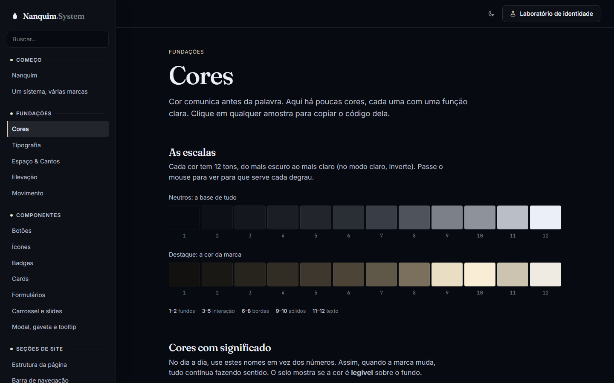
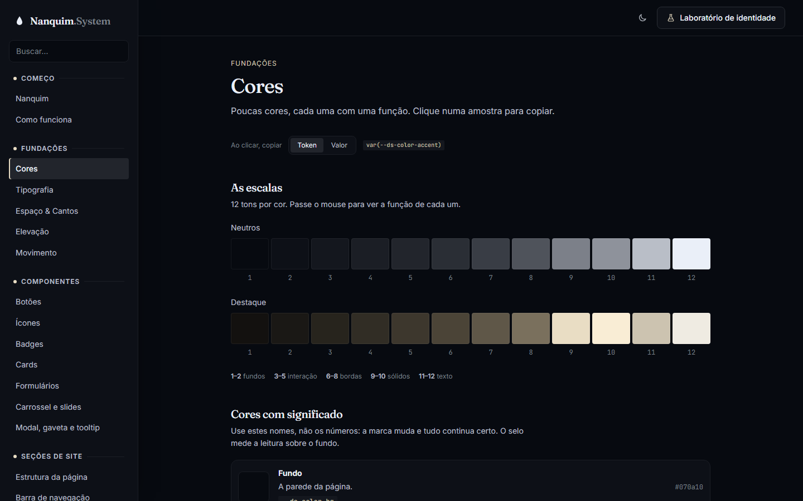

# 013 — Textos enxutos e cópia de valores

**Data:** 2026-10-23 · **Versão:** 0.11.0 · **Prints:** [`prints/2026-10-23_textos-enxutos/`](prints/2026-10-23_textos-enxutos/)

## Contexto
O tema do Nanquim é ser minimalista de um jeito artístico, mas a documentação falava demais e em letra grande. Pedi:
- textos mais curtos e mais claros;
- tudo literalmente menor;
- copiar uma cor de dois jeitos: o nome do token e as informações para recriá-la em outro sistema.

## O que foi feito
- **Textos reescritos em todas as 25 páginas:**
  - abertura de uma frase;
  - parágrafos de uma linha;
  - faça/evite com dois itens;
  - descrições de variantes em poucas palavras.
- **Casco menor:**
  - título de 36px no máximo (antes 60px);
  - abertura em 16px (antes 18px);
  - títulos de seção em 20px (antes 24px);
  - texto corrido em 14px;
  - menos espaço entre seções;
  - menu mais estreito;
  - código em letra menor.
- **Cópia em dois formatos** nas páginas de Fundações (cores, tipografia, espaço, elevação, movimento). Um seletor "Ao clicar, copiar: Token | Valor" mostra um exemplo real:
  - **Token** copia `var(--ds-color-accent)`, para usar dentro do sistema;
  - **Valor** copia a declaração pronta: `--ds-color-accent: oklch(0.9 0.035 85); /* #e9ddc4 */`, medidas em px, fontes, sombras e durações.
- "Um sistema, várias marcas" virou **"Como funciona"**. A página ganhou "O que tem dentro" e o caminho do zero ao site do cliente.

## Decisões (e por quê)
| Decisão | Alternativas consideradas | Motivo |
|---|---|---|
| Um seletor por página para o formato da cópia | Dois botões em cada amostra | As amostras da escala são pequenas; dois botões em cada uma poluiriam a página |
| O seletor mostra um exemplo real do que vai ser copiado | Só os nomes "Token" e "Valor" | Quem não conhece o termo vê na hora a diferença |
| Valor da cor em OKLCH com o hex em comentário | Só o hex | OKLCH é a fonte exata do sistema; o hex serve para Figma e qualquer outro lugar. Cores com transparência ficam sem hex, porque ele mentiria |
| Medidas resolvidas em px | Copiar `calc(1rem * var(--ds-space-scale))` | O valor cru depende de outros tokens e não funciona fora do sistema |
| A escolha fica lembrada no navegador | Voltar sempre para "Token" | Quem está montando outro sistema copia vários valores seguidos |

## Problemas encontrados
- **Tokens de espaço não são cores:** a primeira versão da cópia só sabia ler cores. Agora ela identifica o tipo: cores, medidas (medidas com uma sonda invisível) ou o valor como está (fontes, sombras, curvas).
- **Sombras em várias linhas:** o valor vinha com quebras de linha do CSS original. Agora fica numa linha só.
- **Aviso cortado:** o aviso de cópia cortava o texto em 40 caracteres e escondia o hex. Agora o limite é 64.

## Antes / depois
| Antes (v0.10.0) | Depois (v0.11.0) |
|---|---|
|  |  |

## Aprendizados
- Cortar texto é decidir o que importa. Quase sempre sobra uma frase que diz tudo.
- Um token tem duas vidas: dentro do sistema ele é um nome; fora dele, precisa virar valor.

## Próximos passos
- [ ] Pacote para usar em outros projetos (npm e CDN)
- [ ] Primeiro site de cliente feito só com o Nanquim

## Ideia de post
> **"Menos palavras, mesma ideia."** Reescrevi toda a documentação do Nanquim System com metade do texto e letra
> menor. De quebra, cada cor agora pode ser copiada como token ou como valor pronto para outro projeto.
> Print sugerido: a página de Cores com o seletor "Token | Valor".
