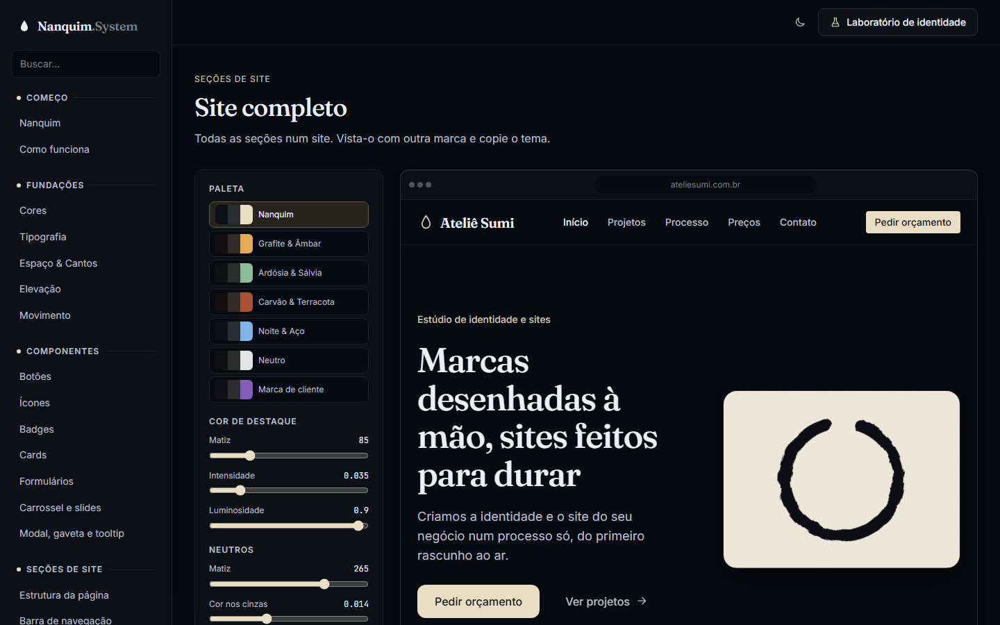
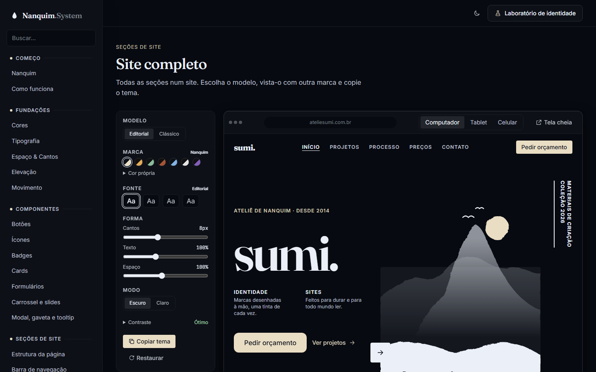

# 014 — Modelo editorial e tela cheia com gaveta

**Data:** 2026-10-23 · **Versão:** 0.12.0 · **Prints:** [`prints/2026-10-23_modelo-editorial/`](prints/2026-10-23_modelo-editorial/)

## Contexto
O site de exemplo funcionava, mas parecia um modelo genérico. Mandei três referências de landings editoriais em preto e branco:
- "lab." com uma figura recortada sobre um bloco cinza;
- "Joker", com título enorme e indicadores;
- "LAB. WORKS", com chapéu cônico e textos miúdos.

Pedi:
- um site de exemplo mais elaborado, buscando padrões em plataformas de templates;
- um painel de edição mais simples;
- uma tela cheia em que a edição fique numa barra lateral que abre e fecha.

## Pesquisa
No Dribbble e na prévia do Pinterest (que pede login para ver mais), os mesmos padrões se repetem:
- tipografia gigante, às vezes cortada na borda;
- uma figura grande sobre um bloco;
- texto vertical e blocos de texto miúdo em caixa alta;
- listas numeradas (01, 02…) separadas por fios;
- portfólio em grade assimétrica;
- números grandes como prova;
- o nome da marca enorme no rodapé.

## O que foi feito
- **Modelo Editorial do site completo.** O modelo anterior continua como **Clássico**. A ordem das seções:
  1. barra editorial;
  2. hero editorial;
  3. manifesto;
  4. serviços numerados;
  5. projetos;
  6. números;
  7. depoimentos em carrossel;
  8. preços;
  9. perguntas;
  10. chamada;
  11. rodapé com assinatura gigante.
- **Peças novas, cada uma com página:**
  - `ds-statement` (manifesto);
  - `ds-index` (lista numerada);
  - `ds-works` (projetos);
  - `ds-stats` (números).
- **Variantes:**
  - `ds-hero--editorial`, com título gigante, colunas de texto miúdo, imagem que sobe além do bloco, botão quadrado no canto e texto vertical;
  - `ds-navbar--editorial`;
  - `ds-footer__wordmark`.
- **Tokens:** `--ds-text-7xl`, `8xl`, `9xl`, `--ds-leading-none` e `--ds-tracking-tighter`.
- **Ilustração nova, `inkLandscape()`:** montanhas sumi-e em aguada que se dissolvem na base, com o sol na cor de destaque. Ela segue a cor do texto, então serve a qualquer marca e aos dois modos.
- **Painel mais simples:**
  - modelo;
  - marcas como bolinhas;
  - "Cor própria" recolhida;
  - fontes numa linha só;
  - forma;
  - modo;
  - contraste resumido numa palavra.
- **A largura da prévia e a tela cheia foram para a barra da prévia.** Na tela cheia, o site ocupa a janela e o painel vira uma **gaveta**, aberta e fechada pelo botão "Editar". O Esc fecha primeiro a gaveta e depois a tela cheia.

## Decisões (e por quê)
| Decisão | Alternativas consideradas | Motivo |
|---|---|---|
| Dois modelos, Editorial e Clássico | Trocar o modelo antigo | Um cliente sóbrio pode preferir o clássico; os dois servem de vitrine |
| Padrões editoriais viraram peças do sistema | Estilos só no exemplo | O que aparece no exemplo precisa existir para usar num site de verdade |
| Paisagem sumi-e no lugar de uma foto | Foto de banco de imagens ou figura desenhada | Foto não segue a marca. A primeira tentativa, uma figura de chapéu, ficou tosca. Montanhas em aguada são o desenho mais clássico do nanquim |
| Névoa feita com esmaecimento (máscara) | Elipses desfocadas na cor do fundo | No escuro, a "névoa" virava uma mancha; o esmaecimento funciona nos dois modos |
| Fora da tela cheia, o painel fica sempre aberto | Gaveta também na página | Na página há espaço ao lado; a gaveta só faz sentido quando o site ocupa tudo |
| Contraste resumido no pior caso | Lista sempre aberta | Uma palavra basta; o detalhe abre quando a pessoa quer |

## Problemas encontrados
- **A barra do site cobria a gaveta:** a barra fixa do exemplo tinha prioridade de camada maior. A gaveta ganhou uma camada acima dela.
- **A tela cheia passava 7px da altura da janela:** a altura era "janela menos 48px", mas a barra da prévia tem 55px. A prévia virou uma coluna flexível, sem conta fixa.
- **Legenda descolada da imagem nos projetos:** na grade assimétrica, o item mais baixo esticava a linha. Cada projeto agora se alinha ao topo.
- **Assinatura do rodapé pequena:** o tamanho é relativo à largura do rodapé (`cqi`). Foi ajustado até ocupar a linha.

## Antes / depois
| Antes (v0.11.0) | Depois (v0.12.0) |
|---|---|
|  |  |

Tela cheia com a gaveta aberta, no claro: [`54-site-neutro-claro.png`](prints/2026-10-23_modelo-editorial/54-site-neutro-claro.png) · landing inteira: [`52-landing-completa.png`](prints/2026-10-23_modelo-editorial/52-landing-completa.png)

## Aprendizados
- Os sites editoriais repetem poucos gestos: escala extrema, muito vazio, texto miúdo e uma imagem forte.
- Uma ilustração que usa a cor do texto e a de destaque se transforma junto com a marca, coisa que uma foto não faz.
- A posição do painel depende do espaço: ao lado quando há espaço, numa gaveta quando o site ocupa a tela.

## Próximos passos
- [ ] Pacote para usar em outros projetos (npm e CDN)
- [ ] Primeiro site de cliente feito só com o Nanquim

## Ideia de post
> **"Uma landing editorial que troca de marca."** Estudei landings de moda e estúdios no Dribbble e transformei os
> padrões delas em peças do Nanquim System: título gigante, lista numerada, portfólio assimétrico. A paisagem em
> nanquim muda de cor com a marca, e o painel de edição vira uma gaveta na tela cheia.
> Print sugerido: a tela cheia no modo claro com a gaveta aberta.
