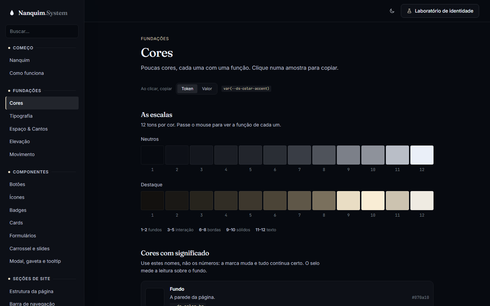
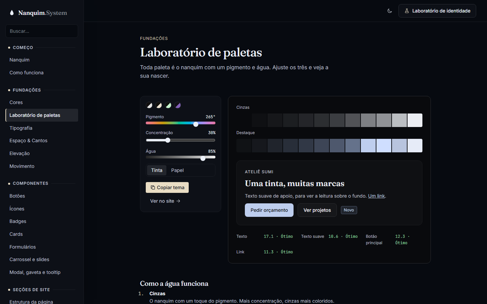

# 015 — Aguada, laboratório de paletas, Vitrine e Grade

**Data:** 2026-10-23 · **Versão:** 0.13.0 · **Prints:** [`prints/2026-10-23_aguada-vitrine-grade/`](prints/2026-10-23_aguada-vitrine-grade/)

## Contexto
Mandei duas referências e pedi para extrair o design system delas e aplicar no site completo:
- uma loja de moda em preto e branco, com o nome gigante atrás da figura;
- um site de consultório com fundo quadriculado escuro e hero num cartão claro.

No meio do trabalho, vieram mais quatro pedidos:
- um **agente** para levar as variantes novas às páginas de cada seção;
- um **Laboratório de paletas** logo abaixo de Cores;
- que as paletas da casa fossem **derivadas do nanquim e da água**, como a página de abertura promete;
- retirar as paletas que só estavam ali para variar.

## O que foi feito
- **Aguada (`src/themes/aguada.css`):** toda paleta é o nanquim com três números:
  - pigmento (o tom);
  - concentração (quanto pigmento entra);
  - água (quanto o destaque é diluído).

  Os cinzas, o destaque, a versão para o papel (modo claro) e a cor do texto do botão saem de uma fórmula só.
- **Paletas da casa:** Nanquim (a tinta-mãe), Carvão (tinta pura), Vitrine, Verde-água e Marca de cliente. Grafite, Ardósia, Terracota e Aço foram retiradas.
- **Laboratório de paletas:** controles de pigmento, concentração e água, com as duas escalas, uma amostra de interface e o contraste medido. Também copia o tema (três linhas) e abre a paleta direto no site completo.
- **Modelo Vitrine** (da loja de moda): faixa de aviso, marca no centro, "SUMI" gigante atravessado pelo ensō, faixa invertida de categorias, vantagens com ícone e vitrine de produtos. Usa a fonte Geométrica (Jost) e cantos retos.
- **Modelo Grade** (do consultório): fundo quadriculado, hero num cartão claro com menu em células e o título "TINTA / viva" alternando negrito e fino. Os cabeçalhos ficam divididos, com o título à esquerda e o texto à direita, e os cards espalhados pela grade. Usa a fonte Condensada (Oswald).
- **Peças novas:**
  - `ds-announcement`;
  - `ds-navbar--center` e `--cells`;
  - `ds-hero--poster` e `--framed`;
  - `ds-section--grid` e `__header--split`;
  - `ds-card--plain` (com `__price` e `__corner`);
  - `ds-feature--inline`;
  - `ds-works--scatter`;
  - o token `--ds-display-transform`, para títulos em caixa alta.
- **Agente nas seções:** um agente separado documentou as variantes nas páginas de barra de navegação, hero, estrutura, recursos, projetos e cards. Ele mexeu só nesses arquivos, enquanto eu fazia as paletas.

## Decisões (e por quê)
| Decisão | Alternativas consideradas | Motivo |
|---|---|---|
| Paleta = pigmento + concentração + água | Manter os cinco números soltos (matiz e croma de cada escala) | É a metáfora da casa virando regra. Três números bastam, e a fórmula garante o contraste |
| No papel, a tinta aparece com menos água | Usar a mesma luminosidade nos dois modos | Um destaque claro some no fundo claro; no papel, a tinta precisa ser mais escura para ser lida |
| `@scope (...) to ([data-theme])` no Nanquim | Repetir as regras para cada combinação de tema e modo | Trechos invertidos pegam o lado certo do tema, e um tema nunca vaza para dentro de outro |
| `data-invert` nos trechos dos modelos | Fixar `data-mode="dark"` | A faixa de categorias precisa continuar invertida quando a pessoa troca o modo da página |
| Escolher o modelo aplica a identidade dele | Só trocar o HTML | A Vitrine sem a fonte geométrica e os cantos retos não parece a referência |
| Agente só nas páginas de seção | Agente em tudo | Duas sessões editando os mesmos arquivos se atropelam |

## Problemas encontrados
- **Destaque preto numa faixa escura:** os ajustes de destaque do modo claro só valiam no elemento com tema e modo juntos. Isso foi resolvido com `@scope` e, nas paletas derivadas, com a fórmula recalculada em cada `[data-mode]`.
- **O site completo rolava 3px para o lado no celular:** a grade de projetos tinha 12 trilhos, e os 11 espaços somavam mais que a largura da tela. No celular, ela agora tem uma coluna só.
- **"Kit ensō" aparecia como "enso¯"** na fonte Geométrica, que não tem o "ō". O agente apontou, e o produto virou "Kit iniciante".

## Antes / depois
| Antes (v0.12.0) | Depois (v0.13.0) |
|---|---|
|  |  |

Modelos: [`49-site-vitrine.png`](prints/2026-10-23_aguada-vitrine-grade/49-site-vitrine.png) · [`50-site-grade.png`](prints/2026-10-23_aguada-vitrine-grade/50-site-grade.png)

## Aprendizados
- Um conceito vira sistema quando vira fórmula: "uma tinta, muita água" agora é literalmente como as cores nascem.
- Inverter um trecho da página exige que o tema saiba o próprio lado, não só a página inteira.
- Para trabalhar em paralelo com um agente, o que importa é dividir os arquivos antes de começar.

## Próximos passos
- [ ] Pacote para usar em outros projetos (npm e CDN)
- [ ] Primeiro site de cliente feito só com o Nanquim

## Ideia de post
> **"Toda cor do meu design system é tinta com água."** Reescrevi as paletas do Nanquim System como uma fórmula de
> aguada: pigmento, concentração e água. Três números geram os cinzas, o destaque e até a cor do texto do botão, já
> com contraste garantido.
> Print sugerido: o Laboratório de paletas com o Verde-água no modo papel.
