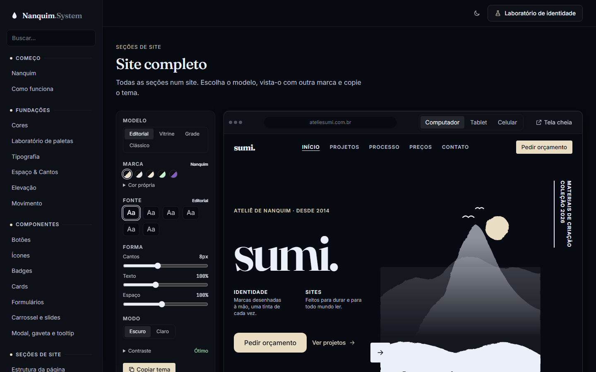
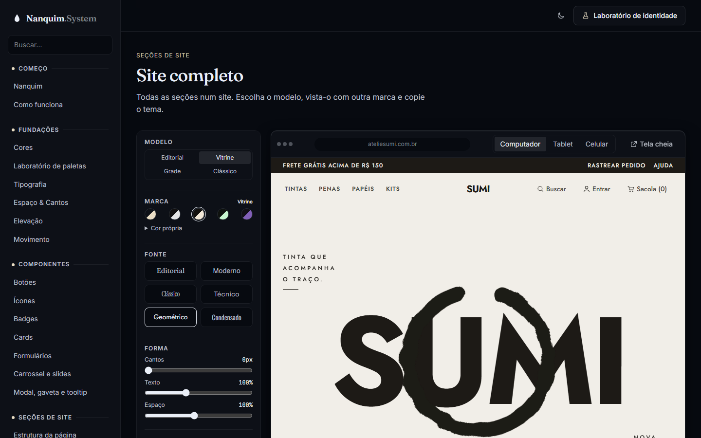

# 016 — Vitrine como padrão e painel em grade

**Data:** 2026-10-23 · **Versão:** 0.13.1 · **Prints:** [`prints/2026-10-23_painel-vitrine/`](prints/2026-10-23_painel-vitrine/)

## Contexto
Pedi para a Vitrine virar o modelo padrão do site completo e para organizar melhor o painel lateral de edição: uma grade bem colocada, sem elemento solto numa linha sozinho.

## O que foi feito
- **A Vitrine é o padrão:** o site completo abre nela, com a identidade dela (paleta Vitrine, fonte Geométrica, cantos retos, modo claro). O "Restaurar" volta para ela.
- **Painel em grade:**
  - modelos em 2×2, antes 3 + 1;
  - as 5 marcas numa linha só;
  - fontes em 3 linhas de 2, antes 4 + 2;
  - modo e ações em duas colunas de largura igual;
  - um fio fino separando os grupos.
- **Fontes com a própria letra:** cada botão escreve o nome da fonte na fonte dela ("Condensado" em Oswald, "Clássico" em Instrument Serif). O "Aa", que repetia a mesma informação, saiu.

## Decisões (e por quê)
| Decisão | Alternativas consideradas | Motivo |
|---|---|---|
| Nome da fonte escrito nela mesma | "Aa" + nome; nome cortado com reticências | O botão mostra a letra e diz o nome ao mesmo tempo, e todos os nomes cabem inteiros |
| Colunas iguais em todos os grupos | Botões com a largura do texto | Com larguras soltas, o último item caía sozinho na linha de baixo |
| Painel 16rem | Manter 15rem | Duas colunas de fonte precisavam de um pouco mais de espaço |

## Problemas encontrados
- **Todas as fontes apareciam iguais nos botões**, no visualizador e no Laboratório de identidade. O nome vinha entre aspas duplas (`"Fraunces", serif`) e quebrava o `style="…"` do HTML. Agora vem entre aspas simples.
- **Texto que não encurtava:** num flex, um texto só encolhe com `min-width: 0`. A solução final dispensou isso, porque o nome inteiro passou a caber.

## Antes / depois
| Antes (v0.13.0) | Depois (v0.13.1) |
|---|---|
|  |  |

## Aprendizados
- "Sem elemento solto" é uma regra de grade: o número de colunas tem de dividir o número de itens.
- Uma amostra que escreve o próprio nome vale mais que um ícone genérico.
- Um atributo HTML com aspas erradas não dá erro nenhum; só faz o estilo sumir em silêncio.

## Próximos passos
- [ ] Pacote para usar em outros projetos (npm e CDN)
- [ ] Primeiro site de cliente feito só com o Nanquim

## Ideia de post
> **"Nada solto."** Reorganizei o painel do visualizador do Nanquim System numa grade em que o número de colunas
> divide o número de itens, e cada fonte agora escreve o próprio nome. Pequeno, mas é o tipo de cuidado que se vê.
> Print sugerido: o painel com a Vitrine aberta ao lado.
